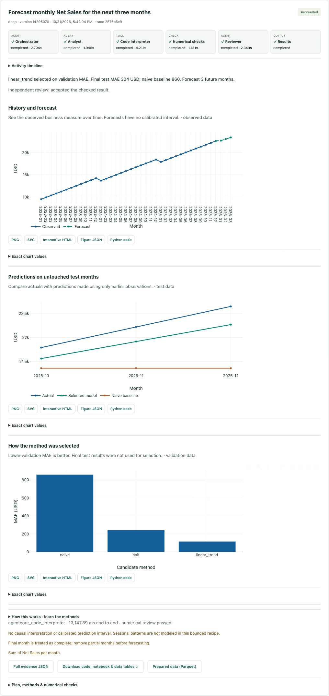

# Virtual Data Scientist

Upload CSV or Excel and ask a business question. Automatic preparation identifies
the table, header, types and analytical fields, then Strands plans the work in
AWS AgentCore. Monthly charts run through DuckDB in the hosted container;
forecasts run in AgentCore Code Interpreter, pass independent numerical checks,
and receive a separate model review. Sources, typed Parquet, results and audit
artifacts live in S3; job state lives in DynamoDB.



## Deployed development environment

The separate `VirtualDataScientistV2Dev` stack is deployed in `us-east-1`.
Release `dev-20261031-15` uses an immutable ARM64 Docker image in ECR and
`us.amazon.nova-pro-v1:0`. CSV and Excel chart/forecast tests passed against the
real runtime. The original runtime and public website were not switched.

[Deployment manifest](docs/deployment/dev-20261031-15.json) ·
[Live acceptance](docs/deployment/2026-10-31-live-acceptance.json) ·
[Validation](docs/validation.md) · [Architecture and continuation](project_context.md)

## Open the hosted workspace

Open [the restricted development workspace](https://analyst.decision-layer.com/).
Cognito sign-in and a hosted Lambda gateway derive ownership from verified access
tokens. Static files, preparation, analysis and persistent state are all on AWS;
no local process is required. Self-signup is disabled. An administrator must
create a development account before a user can sign in. No invitation is sent
by the test scripts.

The browser uses authorization code + S256 PKCE and keeps access tokens in memory.
After reload, sign in again through the provider session to retrieve saved work.
Datasets/evidence expire through asynchronous seven-day lifecycle/TTL policies;
login accounts have a separate administrator-managed lifecycle.
[Hosted architecture and operating limits](docs/hosted-development-access.md) ·
[Hosted acceptance](docs/deployment/2026-10-31-hosted-acceptance.json)

Upload the sample from the sidebar, ask “Show monthly revenue,” then “Forecast the
next three months.” There are no required sheet/header/date/target/algorithm
selectors. Preparation asks a short business clarification when necessary. Include
the clarification in the question before another upload. Inferred definitions,
units and analytical limits remain visible.

## Interactive analysis experience

After profiling, supported analysis suggestions explain why they fit the data.
Results include reviewed methodology lessons, interactive Plotly figures, four
palettes, exact values and real agent/tool activity. Forecasts include history,
untouched test predictions and validation-only model comparison.

Download PNG/SVG, self-contained chart HTML, figure JSON/Python, full evidence,
or a ZIP with analysis code, support modules, notebook, SQL and result tables.
Prepared Parquet is a separate explicit download. The downloaded analysis was
executed in a fresh AgentCore Interpreter and reproduced the saved test metrics.

English dictation records up to twenty seconds, then streams Amazon Transcribe
results after Stop. Edit the transcript before submitting. Workflow streaming
uses single-use tickets, persisted events and replay; it never starts another job.
The private `vds-v2-development` CloudWatch dashboard covers outcomes, latency,
quality gates, gateway health and measured role-level usage.

The five-analysis guest trial and account-claim path are implemented and live-tested
through a temporary IAM-only AWS endpoint. Anonymous access and self-signup remain
off. Invited development accounts have a twenty-analysis allowance, with a shared
cumulative twenty-admission guard and conservative token reservations. See
[operations](docs/operations.md), [current verification](docs/deployment/dev-v2-verification.json),
[trial acceptance](docs/deployment/dev-v2-trial-acceptance.json) and
[export reproduction](docs/deployment/dev-v2-export-reproduction.json).

## Optional local developer bridge

Python 3.13+ and an authorized AWS SDK session:

```bash
python3 -m venv .venv
.venv/bin/python -m pip install -r requirements-demo.lock.txt
export VDS_RUNTIME_ARN=arn:aws:bedrock-agentcore:us-east-1:441383083571:runtime/VirtualDataScientistV2Dev-Tr4IBoExJp
PORT=8876 .venv/bin/python server.py
```

This loopback bridge at http://127.0.0.1:8876 is useful for development and retains
its cookie-based demo identity. It is separate from the verified-user hosted
workspace. Do not expose it or the legacy `/studio` and MCP APIs publicly.

## Implemented analytical scope

- Automatic CSV delimiter/table/header and Excel sheet/header detection;
  dates, currency, percentages, missingness, duplicates, time coverage and
  leading-zero identifiers; immutable source/Parquet hashes and saved profile.
- A model planner infers the question's business fields from the profile and
  previous brief. Deterministic validation checks actual names/types and recipes.
- Calendar-month sums and charts with source-based total checks. The hosted
  quick path invokes the planner once and performs aggregation in DuckDB.
- Forecasts compare naive, Holt and linear trend using chronological validation,
  then evaluate once on a later test period and refit for the future horizon.
  Trusted refits and source/metric checks precede independent narrative review.
- Analyst code is restricted to an approved recipe wrapper. At most one repair
  of rejected code is allowed before execution. Each accepted analysis gets a
  fresh sandbox; uncertain execution is never blindly replayed.
- Conditional per-run state, idempotency, plan revisions, admission leases,
  cancellation, deletion, saved evidence and cross-session reconnect.
- Fixed regression/classification recipes and a synthetic deal-risk registry
  remain locally tested examples. They are not enabled in the new cloud path.
  External research is not configured; required research fails explicitly.

## Bounds and lifecycle

Uploads: 10 MiB source, 50 MiB expanded XLSX, 100 columns, 100,000 rows and one
million cells. Formulas must be exported as values. Storage bounds allow ten
versions and one hundred saved run records per owner, one active analysis per owner and
two globally. Sandbox execution is bounded to 120 seconds. Runtime idle timeout
is 60 seconds and maximum session lifetime 900 seconds.

Seven-day S3 lifecycle and DynamoDB TTL are configured. Expiry is asynchronous,
not guaranteed deletion at precisely seven days. Explicit deletion revokes
access first and purges the dataset prefix. A late cancelled worker can leave an
inaccessible artifact until lifecycle cleanup. Downloaded copies are outside the
application's deletion boundary. ECR images are retained and incur storage.

Runtime jobs execute in tracked background tasks with DynamoDB leases. An
interrupted container does not resume/replay a job; after lease expiry, the
user sees an interrupted state and can submit a new request. This is not a
durable queue with automatic recovery.

## Reproduce checks

```bash
.venv/bin/python -m pip install -r requirements-test.txt
.venv/bin/python -m unittest discover -s tests -v
.venv/bin/python -m compileall -q analysis_engine scripts model_registry app/CloudDataScientist
node --test tests/auth.test.cjs
node --check static/auth.js
node --check static/workspace.js
.venv/bin/python -m pip check
.venv/bin/python scripts/cloud_acceptance.py --runtime-arn "$VDS_RUNTIME_ARN"
.venv/bin/python scripts/cloud_safety_acceptance.py --runtime-arn "$VDS_RUNTIME_ARN"
```

The last two commands only describe actions. Their `--execute` forms perform
billable cloud work; use them within an explicitly authorized scope.
[Cloud operations](docs/cloud-trial.md) records the actual approval and commands.
The 71-test Python suite and 12 Node tests include mocked AWS state, lifecycle,
quota and browser contracts; live cloud proof is recorded separately. The final
Amazon Linux image scan reports no critical/high findings and two medium OS
findings. [Image review](docs/deployment/dev-v2-image-risk-review.md) and
[operations](docs/operations.md) describe the remaining public-launch boundaries.

Without `VDS_RUNTIME_ARN`, `server.py` runs the local verification backend with
SQLite/fixed recipes. This fallback is useful for repeatable checks; the hosted HTTPS
workspace is the deployed development product. [Historical workbench](docs/legacy-workbench.md)
and [source plans](docs/plans/implementation-plan.md) retain older context.
