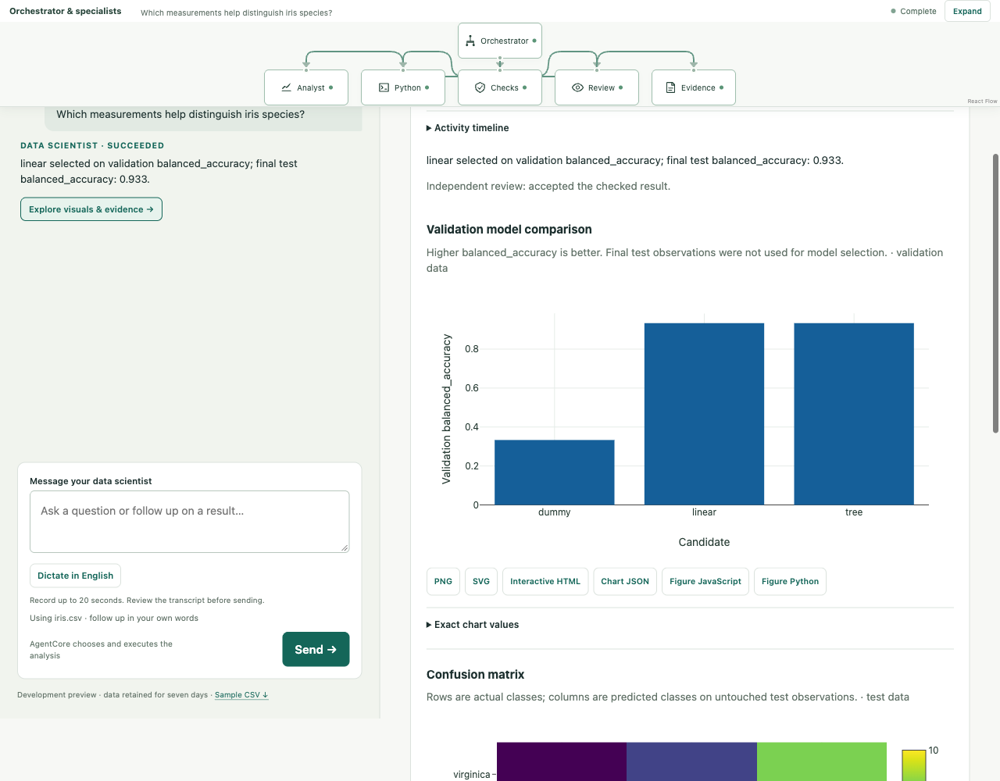
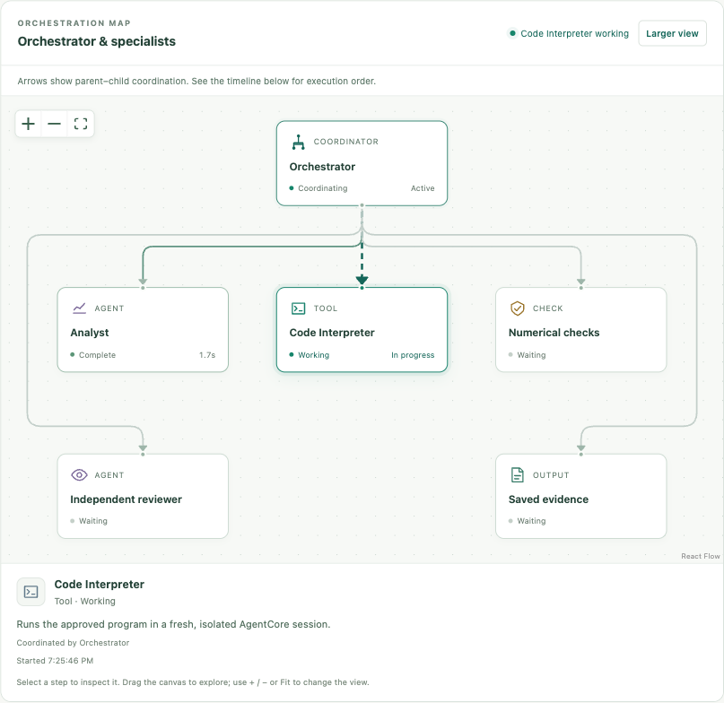

# Virtual Data Scientist

Upload CSV or Excel and ask a business question. Automatic preparation identifies
the table, header, types and analytical fields, then Strands plans the work in
AWS AgentCore. Monthly charts run through DuckDB in the hosted container;
forecasts and reviewed ML recipes run in AgentCore Code Interpreter, pass independent numerical checks,
and receive a separate model review. Sources, typed Parquet, results and audit
artifacts live in S3; job state lives in DynamoDB.



## Deployed development environment

The separate `VirtualDataScientistV2Dev` stack is deployed in `us-east-1`.
Release `dev-20261101-05` uses an immutable ARM64 Docker image in ECR and
`us.amazon.nova-pro-v1:0`. CSV and Excel chart/forecast tests passed against the
real runtime. The new six-method showcase and a real browser upload/classification/export path also passed; the deployment evidence distinguishes releases used for each check. The original runtime and consulting website were not switched.

[Deployment manifest](docs/deployment/dev-20261101-05.json) ·
[ML showcase acceptance](docs/deployment/2026-11-01-ml-showcase-verification.json) ·
[Validation](docs/validation.md) · [Architecture and continuation](project_context.md)

## Open the hosted workspace

Open [the development preview](https://mlworkbench.decision-layer.com/).
The previous analyst subdomain and CloudFront address remain available during the transition.
Cognito sign-in and a hosted Lambda gateway derive ownership from verified access
tokens. Static files, preparation, analysis and persistent state are all on AWS;
no local process is required. Users can register through Cognito for a signed-in
preview of up to 100,000 combined input/output tokens or twenty analyses,
whichever comes first. Anonymous analysis remains disabled. Development-wide
capacity limits also apply; this is not an unlimited public production service.

The browser uses authorization code + S256 PKCE, then exchanges the verified
access token for an opaque HttpOnly/Secure session cookie. Provider tokens are
not persisted. Reload/Back restores the app session within its fifteen-minute
verified lifetime. A pending question, file and stable request key survive sign-in,
and the app continues once without requiring another submit.
Datasets/evidence expire through asynchronous seven-day lifecycle/TTL policies;
login accounts have a separate administrator-managed lifecycle.
[Hosted architecture and operating limits](docs/hosted-development-access.md) ·
[Hosted acceptance](docs/deployment/2026-10-31-hosted-acceptance.json)

Upload the sample from the sidebar, ask “Show monthly revenue,” then “Forecast the
next three months.” There are no required sheet/header/date/target/algorithm
selectors. Preparation asks a short business clarification when necessary. Include
the clarification in the question before another upload. Inferred definitions,
units and analytical limits remain visible.

[Visualization engine research and decision](docs/research/visualization-engine.md) ·
[Chat and login acceptance](docs/deployment/2026-10-31-chat-hosted-acceptance.json) ·
[Final release verification](docs/deployment/dev-v3-chat-verification.json)

## Interactive analysis experience

After profiling, supported analysis suggestions explain why they fit the data.
Chat sits on the left; selected evidence sits on the right. Follow-up analysis
questions preserve the previous plan context. Results include reviewed
methodology lessons, interactive Plotly figures, four
palettes, exact values and a compact persistent React Flow monitor driven by real agent/tool activity. Expand opens the detailed agent view. Forecasts include history,
untouched test predictions and validation-only model comparison.

Download PNG/SVG, self-contained chart HTML, Plotly JSON/JavaScript and Python, full evidence,
or a ZIP with analysis code, support modules, notebook, SQL and result tables.
Readable task-specific scripts/notebooks expose preprocessing, library imports, fitting, validation and numerical checks. Figure code recreates a visual; the full bundle reproduces the analysis. Prepared Parquet is a separate explicit download.

The teaching gallery includes eight frozen, attributed datasets: Iris, Wine, breast cancer, diabetes, Penguins, blobs, moons and seasonal sales. Two reviewed OpenML IDs/versions can also be imported. Loading profiles the data and suggests a question without consuming an analysis; users explicitly send the question. No technical column selection is required.

English dictation records up to twenty seconds, then streams Amazon Transcribe
results after Stop. Edit the transcript before submitting. Workflow streaming
uses single-use tickets, persisted events and replay; it never starts another job.
The private `vds-v2-development` CloudWatch dashboard covers outcomes, latency,
quality gates, gateway health and measured role-level usage.

The five-analysis guest trial and account-claim path are implemented and live-tested
through a temporary IAM-only AWS endpoint. Anonymous access remains off. Signed-in previews have a server-enforced account
allowance with conservative per-request token reservations. A shared cumulative
36-admission guard continues to protect the approved development allowance. See
[operations](docs/operations.md), [current verification](docs/deployment/dev-v2-verification.json),
[trial acceptance](docs/deployment/dev-v2-trial-acceptance.json) and
[export reproduction](docs/deployment/dev-v2-export-reproduction.json).

## Optional local developer bridge

Python 3.13+ and an authorized AWS SDK session:

```bash
python3 -m venv .venv
.venv/bin/python -m pip install -r requirements-demo.lock.txt
export VDS_RUNTIME_ARN=arn:aws:bedrock-agentcore:us-east-1:441383083571:runtime/VirtualDataScientistV2Dev-Tr4IBoExJp
PORT=8876 .venv/bin/python server.py
```

This loopback bridge at http://127.0.0.1:8876 is useful for development and retains
its cookie-based demo identity. It is separate from the verified-user hosted
workspace. Do not expose it or the legacy `/studio` and MCP APIs publicly.

## Implemented analytical scope

- Automatic CSV delimiter/table/header and Excel sheet/header detection;
  dates, currency, percentages, missingness, duplicates, time coverage and
  leading-zero identifiers; immutable source/Parquet hashes and saved profile.
- A model planner infers the question's business fields from the profile and
  previous brief. Deterministic validation checks actual names/types and recipes.
- Calendar-month sums and charts with source-based total checks. The hosted
  quick path invokes the planner once and performs aggregation in DuckDB.
- Forecasts compare naive, damped Holt and linear trend using chronological validation,
  then evaluate once on a later test period and refit for the future horizon.
  Holt fits a deterministic twelve-setting training-only grid; parameters and cutoff refits are recorded. Trusted refits and source/metric checks precede independent narrative review.
- Analyst code is restricted to an approved recipe wrapper. At most one repair
  of rejected code is allowed before execution. Each accepted analysis gets a
  fresh sandbox; uncertain execution is never blindly replayed.
- Conditional per-run state, idempotency, plan revisions, admission leases,
  cancellation, deletion, saved evidence and cross-session reconnect.
- Regression/classification: training-only scikit-learn preprocessing, dummy baseline, linear/tree candidates, validation-only selection and a held-out test; diagnostic figures include residuals, confusion matrices and per-class metrics.
- Clustering: standardized KMeans with bounded silhouette-based candidate selection; PCA: variance/loadings/projection; anomaly detection: IsolationForest scores, threshold and flagged rows. These are exploratory all-row analyses, not predictive holdout evaluations.
- Supervised/exploratory recipes bound inputs to 20,000 rows and 30 features. Targets, known labels, identifiers and possible post-outcome features are excluded. Temporal supervised inputs require clarification. General grouped-data validation and external research are not enabled.

## Bounds and lifecycle

Uploads: 10 MiB source, 50 MiB expanded XLSX, 100 columns, 100,000 rows and one
million cells. Formulas must be exported as values. Storage bounds allow ten
versions and one hundred saved run records per owner, one active analysis per owner and
two globally. Sandbox execution is bounded to 120 seconds. Runtime idle timeout
is 60 seconds and maximum session lifetime 900 seconds.

Seven-day S3 lifecycle and DynamoDB TTL are configured. Expiry is asynchronous,
not guaranteed deletion at precisely seven days. Explicit deletion revokes
access first and purges the dataset prefix. A late cancelled worker can leave an
inaccessible artifact until lifecycle cleanup. Downloaded copies are outside the
application's deletion boundary. ECR images are retained and incur storage.

Runtime jobs execute in tracked background tasks with DynamoDB leases. An
interrupted container does not resume/replay a job; after lease expiry, the
user sees an interrupted state and can submit a new request. This is not a
durable queue with automatic recovery.

## Reproduce checks

```bash
.venv/bin/python -m pip install -r requirements-test.txt
.venv/bin/python -m unittest discover -s tests -v
.venv/bin/python -m compileall -q analysis_engine scripts model_registry app/CloudDataScientist
node --test tests/auth.test.cjs
node --check static/auth.js
node --check static/workspace.js
.venv/bin/python -m pip check
.venv/bin/python scripts/cloud_acceptance.py --runtime-arn "$VDS_RUNTIME_ARN"
.venv/bin/python scripts/cloud_safety_acceptance.py --runtime-arn "$VDS_RUNTIME_ARN"
```

The last two commands only describe actions. Their `--execute` forms perform
billable cloud work; use them within an explicitly authorized scope.
[Cloud operations](docs/cloud-trial.md) records the actual approval and commands.
The 96-test Python suite and 27 Node tests include mocked AWS state, lifecycle,
quota and browser contracts; live cloud proof is recorded separately. The final
Amazon Linux image scan reports no critical/high findings and two medium OS
findings. [Image review](docs/deployment/dev-v2-image-risk-review.md) and
[operations](docs/operations.md) describe the remaining public-launch boundaries.

Without `VDS_RUNTIME_ARN`, `server.py` runs the local verification backend with
SQLite/fixed recipes. This fallback is useful for repeatable checks; the hosted HTTPS
workspace is the deployed development product. [Historical workbench](docs/legacy-workbench.md)
and [source plans](docs/plans/implementation-plan.md) retain older context.

## Build the agent flow viewer

The activity canvas uses React Flow 12.12.0 as a small React island inside the
existing workspace. It supports custom role cards, actual working/completed
states, parent–child coordination arrows, node inspection, pan/zoom/Fit, larger view,
compact mobile routing and reduced motion. Manual inspection and viewport state
survive streamed events. Plotly is the analytical chart engine.

```bash
npm ci --ignore-scripts --prefix frontend/workflow
npm run build --prefix frontend/workflow
node --test tests/workflow.test.mjs
```

Sources and the pinned lockfile are in `frontend/workflow/`. The build produces
self-hosted `static/workflow.js`, CSS and third-party license notices; CI verifies
they reproduce exactly. No React migration of the rest of the app is required.
[Flow acceptance](docs/deployment/react-flow-hosted-acceptance.json) ·
[Implementation plan](docs/plans/react-flow-activity.md)



The orchestrator is the parent of the selected roles, tools and checks. The map
shows who coordinates each capability; the timeline shows execution order. The
coordinator remains active after planning while its children work. The current
backend supports quick summaries and reviewed forecasts, regression, classification, clustering, PCA and anomaly detection. Analyst-only explanation
and separate code-writer routing remain future task contracts.

[November 1 quality audit and cleanup](docs/audits/2026-11-01-ponytail-audit.md) · [Domain migration manifest](docs/deployment/dev-domain-mlworkbench.json)
