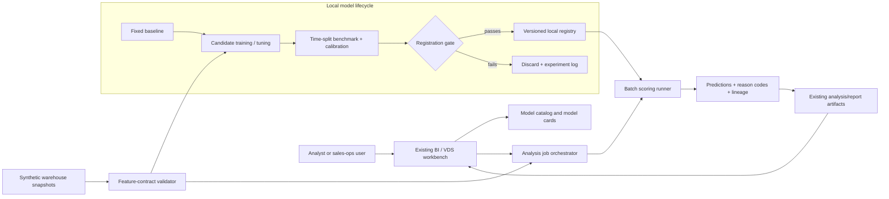

# Sales Analytics Model Registry POC

## Status

The first local deal-risk vertical is implemented and validated. It does not
create or change any AWS resource. The AWS sections below remain a target
architecture rather than a deployment record.

The concept fits naturally as the next governed capability of the existing
Agentic BI / Virtual Data Scientist project. That project already has dataset
upload, schema inspection, analysis sessions, artifacts, reports, an AgentCore
orchestration surface, and an AWS backend. Extending those boundaries avoids
building a second portal and data-ingestion system solely to demonstrate a
registry.

Project mode: **production-adjacent POC + portfolio**.

## Product idea, made precise

The loose version is:

> Let users quickly use our fine-tuned models on their datasets.

The safer and more implementable contract is:

> Let an authorized user discover an approved analytical task, map a governed
> warehouse snapshot to its versioned feature contract, run or retrain an
> approved model recipe, and receive predictions, explanations, metrics, and
> lineage as durable analysis artifacts.

“Any dataset” cannot be the contract. A registered model expects features with
specific meanings, units, time boundaries, null policies, and label horizons.
The platform's differentiator is therefore not just a collection of serialized
models; it is **model version + feature contract + benchmark + intended use +
execution policy**.

## Two distinct services

The POC should keep these modes separate:

1. **Run an approved model** — score a conforming warehouse snapshot with a
   specific approved version.
2. **Tune an approved recipe** — train a new candidate on an authorized business
   slice, evaluate it against fixed gates, and register it as `PendingReview`.

The first path is an inference product. The second is an ML development and
governance product. Combining them behind one button would obscure cost,
permissions, leakage risk, and approval state.

## Candidate use cases

| Use case | Correct analytical framing | Candidate baseline / model | Primary benchmark | Important trap |
|---|---|---|---|---|
| Service revenue change | Time-series decomposition and driver attribution | Seasonal naive baseline, regularized regression, gradient boosting | Forecast error plus driver stability | Calling correlation or mix shift “causal” |
| Team coverage | Demand forecast followed by constrained optimization | Count/volume forecast + linear or mixed-integer optimizer | Coverage gain subject to capacity constraints | Treating an allocation policy as a prediction model |
| Deal risk | Time-aware classification or survival analysis | Logistic regression, calibrated gradient boosting | PR-AUC, calibration, recall at review capacity | Post-outcome leakage from late stage/activity fields |
| Revenue versus quota | Hierarchical forecast and variance attribution | Seasonal baseline, hierarchical/quantile regression | Weighted error and interval coverage | Mixing target-setting policy with forecast accuracy |
| Churn | Time-to-event or horizon-based classification | Survival baseline, gradient-boosted survival/classifier | Concordance or PR-AUC plus calibration | Censoring, renewal timing, and proxy leakage |
| Sales-cycle duration | Survival/regression with censored open deals | Accelerated failure-time baseline or gradient boosting | MAE/concordance by cohort | Training only on closed deals |
| Team activity | Anomaly detection or leading-indicator research | Robust z-score baseline, isolation model, lagged regression | Precision at review capacity and stability | Turning activity volume into a simplistic performance score |

## Recommended first vertical

Start with **deal risk on weekly opportunity snapshots** if the goal is to prove
the registry and tuning workflow. It has:

- a clear batch-scoring user journey;
- a supervised target that can be time-bounded;
- meaningful baselines;
- calibration and explanation requirements;
- natural connections to pipeline, activity, coverage, product usage, and quota;
- visible leakage and governance risks that make the project technically credible.

A suitable first target is narrower than “will this deal close?”:

```text
At weekly snapshot time T, will this open opportunity be lost or slip more than
30 days beyond its current close date within the next 30 days?
```

That target fixes the observation time, outcome horizon, and definition of risk.
All features must be computable as of `T`; later edits, final stage, and outcome
fields are forbidden.

If deal-risk labels or snapshot history are unavailable, service-revenue change
is the better first vertical, but it should be framed as forecasting and driver
decomposition rather than as a generic fine-tuning task.

## Example feature contract

```yaml
contract_id: deal-risk-weekly-v1
entity_key: opportunity_id
observation_time: snapshot_date
prediction_horizon_days: 30
required_features:
  - stage_at_snapshot
  - amount_at_snapshot
  - age_days
  - days_in_current_stage
  - days_until_stated_close
  - close_date_change_count_30d
  - activity_count_14d
  - days_since_last_activity
  - coverage_role_count
  - product_usage_trend_28d
label: lost_or_slipped_30d
forbidden_features:
  - final_stage
  - actual_close_date
  - closed_lost_reason_entered_after_snapshot
```

The contract should also define types, units, allowed ranges, null behavior,
categorical vocabulary, freshness, warehouse-view version, and access policy.

## POC user experience

```text
1. Open Model Catalog
2. Select “Deal Risk — Weekly Snapshot”
3. Read intended use, limitations, owner, metrics, and approved version
4. Select a governed warehouse view or uploaded synthetic dataset
5. Map columns and run schema/leakage/freshness preflight
6. Choose “Score with approved version” or “Create tuning candidate”
7. Run an asynchronous batch job
8. Inspect risk scores, calibration, reason codes, segment metrics, and failures
9. Publish the result as a Virtual Data Scientist analysis/report artifact
10. For a tuned candidate, submit the model version for human approval
```

The agent can explain the catalog and orchestrate tools, but it may not bypass a
feature contract, start an unapproved training job, approve a model, or turn a
risk score directly into a personnel decision.

## Local-first POC architecture



Implemented local boundaries:

- JSON-backed versioned registry metadata and audit events;
- synthetic weekly opportunity, usage, activity, quota, and coverage snapshots;
- dependency-free constant-risk and standardized logistic-regression baselines;
- chronological train/test split and point-in-time feature audit;
- existing workbench UI with catalog, evaluate, approve, and score actions;
- explicit `PendingReview` to `ApprovedForDemo` transition;
- batch scores with reason codes, model version, and feature-contract lineage;
- no production warehouse connection or real customer/employee data.

## Local benchmark evidence

The deterministic synthetic benchmark contains 360 weekly opportunity snapshots:
270 chronological training rows followed by 90 held-out rows. The test begins
after the final training snapshot, and the feature audit rejects post-outcome
fields before training or scoring.

| Metric | Constant-risk baseline | Logistic candidate |
|---|---:|---:|
| Brier score (lower is better) | 0.201 | 0.137 |
| Average precision | 0.312 | 0.716 |
| Recall in top 10% review capacity | 0.120 | 0.280 |

The candidate passed the fixed local gates: at least 0.015 Brier improvement,
0.10 average-precision lift, and 0.15 top-decile recall. These results validate
the benchmark and registry workflow only; synthetic results are not evidence of
real-world deal-risk accuracy.

During validation, the average-precision implementation exposed a useful metric
engineering failure: tuple sorting used the true label to break equal-score
ties, making a constant predictor appear perfect. Sorting solely by probability
fixed the leakage. The regression test now ensures constant-baseline average
precision remains below 1.0.

## AWS target architecture

```mermaid
flowchart LR
    WAREHOUSE["Governed warehouse views"] --> SNAPSHOT["Point-in-time feature snapshot"]
    SNAPSHOT --> S3["Versioned encrypted S3 input"]
    S3 --> PIPELINE["SageMaker Pipeline"]

    PIPELINE --> PROCESS["Validate + preprocess"]
    PROCESS --> TRAIN["Train / tune candidate"]
    TRAIN --> EVAL["Time-split evaluation"]
    EVAL --> CONDITION{"Quality gates"}
    CONDITION -->|"pass"| REGISTRY["SageMaker Model Registry"]
    CONDITION -->|"fail"| EVIDENCE["S3 metrics + failure artifact"]

    REGISTRY --> APPROVAL{"Human approval status"}
    APPROVAL -->|"approved"| BATCH["SageMaker Batch Transform"]
    BATCH --> RESULTS["S3 prediction + explanation output"]
    RESULTS --> ATHENA["Warehouse / Athena consumption"]
    ATHENA --> VDS["Existing BI / VDS report surface"]

    ORCH["API + Step Functions job control"] --> PIPELINE
    ORCH --> BATCH
    ORCH --> AUDIT["CloudWatch + durable audit events"]
```



Why batch first:

- sales and usage datasets are naturally snapshot/batch oriented;
- users need full-table outputs that can be joined back into analytics;
- there is no continuously billed endpoint;
- the job boundary makes dataset version, model version, output location, and
  cost visible;
- SageMaker Batch Transform is intended for large-dataset inference when a
  persistent endpoint is unnecessary.

## AWS service choices and non-choices

- **SageMaker Model Registry:** organize each analytical task as a model group
  and each trained candidate as a version with approval state, metrics, and
  lineage. Model Registry supports versioned groups and approval workflows.
- **Model Cards:** store intended use, exclusions, owners, training/evaluation
  details, business risk, and known limitations alongside versions.
- **SageMaker Pipelines:** implement validate → train → evaluate → conditional
  register, with a failed candidate still producing evidence.
- **Batch Transform:** initial consumption path; add a real-time endpoint only
  if a measured interactive-latency requirement emerges.
- **S3 + warehouse/Athena:** durable snapshots, artifacts, predictions, and
  join-back consumption.
- **Feature Store:** not required for the first batch POC. Existing governed
  warehouse views plus point-in-time snapshots are simpler. Reconsider Feature
  Store when shared reusable features or online/offline consistency becomes a
  concrete requirement.
- **MLflow:** optional experiment UI. Managed MLflow can register models into
  SageMaker Model Registry, but the POC should avoid maintaining two competing
  sources of lifecycle truth.
- **Model Monitor and Clarify:** do not make a new platform depend on them.
  Current AWS documentation says new-customer access closes on July 30, 2026.
  Use explicit batch drift, quality, subgroup, and feature-attribution jobs with
  durable reports and CloudWatch metrics instead.

Official references:

- [SageMaker Model Registry model groups and versions](https://docs.aws.amazon.com/sagemaker/latest/dg/model-registry-models.html)
- [SageMaker Model Cards](https://docs.aws.amazon.com/sagemaker/latest/dg/model-cards.html)
- [Registering model versions from Pipelines](https://docs.aws.amazon.com/sagemaker/latest/dg/model-registry-version.html)
- [SageMaker Batch Transform](https://docs.aws.amazon.com/sagemaker/latest/dg/batch-transform.html)
- [SageMaker Feature Store](https://docs.aws.amazon.com/sagemaker/latest/dg/feature-store.html)
- [MLflow registration into SageMaker Model Registry](https://docs.aws.amazon.com/sagemaker/latest/dg/mlflow-track-experiments-model-registration.html)
- [Model Monitor availability notice](https://docs.aws.amazon.com/sagemaker/latest/dg/model-monitor.html)
- [Clarify availability notice](https://docs.aws.amazon.com/sagemaker/latest/dg/clarify-configure-processing-jobs.html)

## Registry record: minimum useful metadata

Every model version should carry:

- analytical task and model group;
- owner, reviewer, and business risk tier;
- intended and prohibited uses;
- training code/container version;
- training dataset snapshot/query/hash and observation window;
- feature-contract version and label definition;
- split strategy and leakage audit;
- baseline and candidate metrics with time/segment breakdowns;
- calibration and decision threshold;
- explanation method and reason-code vocabulary;
- artifact URI and inference/preprocessing contract;
- approval status, approver, expiry, and retraining trigger;
- known limitations and rollback predecessor.

## Evaluation contract for the first vertical

For deal risk, one accuracy number is inadequate. The fixed report should include:

- naive and logistic-regression baselines;
- PR-AUC because risk events may be imbalanced;
- calibration/Brier score because users interpret scores as risk;
- recall and precision at the team's actual weekly review capacity;
- results by time period, segment, region, deal size, and stage;
- temporal backtests across multiple cutoff dates;
- missingness, freshness, and schema failures;
- top reason-code stability;
- inference runtime and batch cost;
- explicit leakage tests for every feature timestamp.

The primary metric should be business-capacity aware, for example:

> Recall of future lost/slipped opportunities among the top 10% of scores, with
> a calibration and minimum-precision guardrail.

## Agentic-system layer

The existing Virtual Data Scientist can become a safe model-registry agent:

```text
user question
  -> classify approved analytical task
  -> retrieve model card and feature contract
  -> inspect selected dataset schema
  -> propose a run or tuning plan
  -> deterministic policy and cost gate
  -> start asynchronous tool/job
  -> monitor status
  -> validate outputs
  -> publish explanation and lineage
```

A later transformer-tuning experiment could specialize a small model for
**analytical task routing and structured run-plan generation**. It should not be
used to perform the numerical deal-risk or revenue prediction itself. The
fine-tuned transformer would emit a schema such as:

```json
{
  "analytical_task": "deal_risk",
  "model_group": "deal-risk-weekly",
  "mode": "batch_score",
  "feature_contract": "deal-risk-weekly-v1",
  "requested_explanations": ["reason_codes", "segment_summary"]
}
```

Deterministic code would verify catalog membership, dataset compatibility,
authorization, cost limit, and approval state before any job begins.

## How this relates to the target role

This POC complements the edge-task project rather than replacing it.

| Role qualification | Edge-task project | Sales model-registry POC |
|---|---|---|
| Fine-tune/distill transformers | Actual local 4-bit QLoRA and offline profiling | Optional tuned analytical router; tabular model tuning and lifecycle platform |
| Prototype agentic systems | Bounded propose → validate → simulate loop | Catalog-aware agent orchestrates schema checks, batch jobs, and explanations |
| Develop benchmarks | Task grounding, evidence, DDIL, latency, memory | Temporal backtests, calibration, capacity metrics, segment robustness, leakage audits |
| Discover/scout research problems | Template sensitivity and edge tradeoffs | Convert sales, finance, analytics, security, and platform needs into model contracts |
| Systems/AWS | Local edge runtime plus guarded SageMaker training reference | Registry, pipelines, batch inference, lineage, approval, monitoring, and cost controls |

Together, the projects tell a stronger story:

- the first proves hands-on transformer adaptation and constrained deployment;
- the second proves that you can turn model research into a reusable, governed
  platform serving multiple business lines.

## Decisions required before an implementation plan

The mandatory first choice is the customization workflow:

- **Evaluate-first (recommended):** build the feature contract, time-split
  benchmark, and simple baseline first; fine-tune or add complexity only after
  inspecting the failure modes. This produces stronger evidence and reduces
  leakage risk, but the first model is intentionally simple.
- **Direct tuning:** commit to a model family and tuning recipe immediately,
  then evaluate it. This gets to a tuning demo sooner, but makes it harder to
  prove whether tuning was necessary or better than a cheap baseline.

After that choice, select the first vertical: recommended `deal_risk`, or
`service_revenue_change` if that better matches the data and stakeholders
available for the POC.
