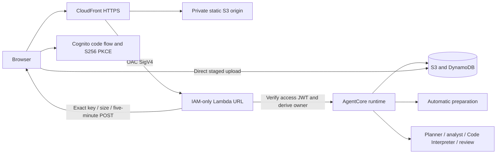

# Restricted hosted development workspace

This slice adds HTTPS access to the existing AgentCore development runtime. It
uses the canonical static workspace; the consulting website remains unchanged.
Actual endpoints and deployment state are recorded in `deployment/`.

## Trust and data flow



The user pool disables self-signup. The public browser client has no secret and
supports only authorization-code OAuth, with S256 PKCE and random callback state.
The gateway accepts only a signed, unexpired access token for the exact configured
issuer/client; ID tokens and supplied owner fields do not authorize access.
Ownership is SHA256(verified issuer + separator + opaque subject), stable across
sign-ins. Cognito subjects are not assumed to be RFC UUIDs.

CloudFront OAC signs the Lambda origin's Authorization header. User access travels
in `x-vds-token`; the browser includes the SHA256 body header for signed POSTs.
API caching is disabled. The Lambda URL and static S3 bucket deny direct anonymous
access. Same-origin browser requests need no wildcard API CORS policy. Dataset
uploads use one exact hosted origin in the private data bucket's CORS policy.

Tokens remain in browser memory; only a ten-minute PKCE transaction uses
sessionStorage. Callback state is checked and removed before exchanging the code,
and the callback code is removed from the visible URL. Reload requires sign-in
again; the identity provider's session can complete that without another password.
Logout clears in-memory access and selected dataset, then visits provider logout.
Offline JWT validation does not provide instantaneous revocation: a previously
issued access token can remain valid until its fifteen-minute expiry. Development
MFA is off. These are explicit production-hardening boundaries.

Uploads go straight to S3 under an owner-bound random incoming ID. The POST policy
requires the declared size, at most 10 MiB, and AES256 encryption, and expires in
five minutes. The runtime receives only the upload ID/name/question, constructs
the bucket/key itself, bounds the object read, prepares the data and removes the
staged object. Neither a client bucket/key nor source bytes pass through Lambda.
The existing automatic table/type/role preparation remains authoritative.

Polling omits recipe/sandbox payloads and includes result bodies within a 2 MiB
budget. Older results remain individually retrievable with an Open saved result
control. Evidence download always fetches the full persisted run. Individual
published evidence is bounded to 2 MiB to fit the hosted synchronous transport.

## Source map and validation commands

- `aws_backend/web_gateway.py`: verified identity, routes, signed runtime calls,
  exact staged-upload policies, sanitized dependency diagnostics.
- `static/auth.js`: PKCE, callback state, in-memory access, sign-in/out and request
  body hashing; local verification keeps its loopback identity.
- `scripts/render_web_stack.py`: separate CloudFormation web resources.
- `scripts/build_web_gateway.py`: ARM64 dependency ZIP, explicit source allowlist.
- `scripts/publish_dev_site.py`: explicit static asset/config allowlist.
- `scripts/hosted_acceptance.py`: synthetic two-user acceptance and one-use
  loopback browser login helper; temporary credentials stay in memory.

```bash
.venv/bin/python -m unittest discover -s tests -v
node --test tests/auth.test.cjs
node --check static/auth.js
node --check static/workspace.js
.venv/bin/python -m py_compile aws_backend/web_gateway.py scripts/render_web_stack.py scripts/hosted_acceptance.py
.venv/bin/python scripts/build_web_gateway.py
.venv/bin/python scripts/render_web_stack.py
.venv/bin/python scripts/publish_dev_site.py
.venv/bin/python scripts/hosted_acceptance.py
```

The last two commands default to review-only. The live forms require `--execute`
within an authorized development scope. The acceptance helper creates only its
own two temporary users with invitations suppressed, bounds its lifetime, and
removes those users at the end. It never saves tokens/passwords or prints signed
upload policies. Its browser-login endpoint is loopback-only and one-use.

## Deployment ordering and operating limits

The initial web stack takes AppOrigin=https://localhost so Cognito callback
registration does not form a circular dependency through CloudFront/Lambda.
After CloudFront exists, update AppOrigin to its actual HTTPS URL, update the
runtime data bucket's WebOrigin to that same URL, then publish assets/config.
The gateway ZIP is uploaded under a content hash before its change set executes.

The account cannot reserve Lambda concurrency without violating AWS's minimum
unreserved allocation. No other account settings were changed. Runtime admission
still bounds analysis to one per owner/two globally; this is not an HTTP request
rate cap. No paid WAF, NAT, provisioned database, custom domain or always-on server
was added. The user approved an initial $10 development allowance, not an AWS
hard cap. Invoice reconciliation remains separate.

Dataset/evidence S3 lifecycle, DDB TTL and logs are seven days, asynchronous.
Cognito accounts and static assets do not expire with dataset retention. Gateway
ZIPs currently share the seven-day data-bucket lifecycle: rebuild/re-upload the
content-hashed package before an older Lambda rollback after that window. A
production release needs a durable deployment-artifact retention policy.

The official container base is pinned and locale is constrained. ECR still
reports four high OS findings; see `deployment/2026-10-31-image-risk-review.md`.
This restricted development environment does not constitute a public production
launch or an exploitability clearance. Production work includes image fixes,
MFA/revocation/rate policy, durable job recovery, broader cloud recipes/research,
real-data accuracy/load validation and a separately reviewed website cutover.

## Actual acceptance

Both stacks completed and the actual user/browser flow passed. See
`deployment/2026-10-31-hosted-acceptance.json` and
`deployment/2026-10-31-hosted-verification.json`. The 58 Python/four Node tests,
real 10 MiB upload, two-user/origin isolation, browser Excel chart/forecast,
reconnect, full download and logout passed. All temporary users were removed.
The owner account is now provisioned. Cognito accepted the requested EMAIL
invitation; inbox delivery and first sign-in remain unconfirmed. Cognito generated
and delivered the temporary password directly; no password/token file was created.
See `deployment/2026-10-31-owner-onboarding.json` for the non-personal record.
