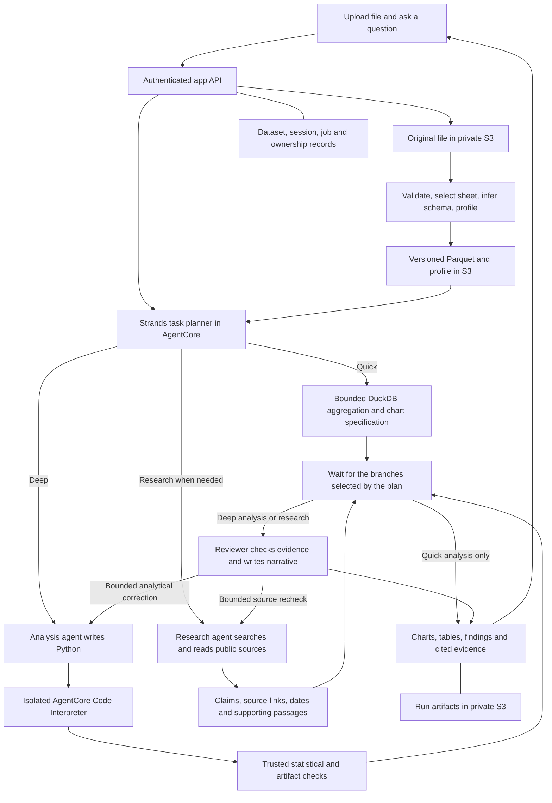

# Virtual Data Scientist: consolidation and implementation plan

Research and code review: October 31, 2026.

Status: proposed implementation plan. No consolidation, application changes, or cloud deployments have been performed as part of this planning pass.

## Product goal and recommended direction

A user uploads a CSV or Excel workbook and asks a question. The application preserves the source, creates a typed Parquet dataset in S3, and selects an appropriate analytical workflow. Simple summaries and charts return quickly. More involved analysis runs in the background through an AgentCore-hosted Strands orchestrator, a Python analysis agent, and a reviewer that checks the evidence and writes the narrative. An optional research agent searches and reads public sources when the question needs outside evidence. Research can also run without an uploaded dataset. Every result links to the applicable dataset version, executed code, outputs, validation evidence, and external sources.

Project mode: portfolio, with explicit steps toward production readiness. Keep the first release focused on tabular analysis and CPU-based models.

Confirmed direction: use Strands Agents for task classification and routing. The orchestrator selects the quick or deep workflow and proposes appropriate analytical methods. Analytical task selection and language-model selection will be represented separately; switching language models is an optional optimization rather than the requested core capability.

Scope extension: include a web research agent. Research is an independent routing decision, so either analysis tier can request external evidence while ordinary charts remain on the quick path.

## What already exists

| Capability | Evidence from the current code | Work required |
| --- | --- | --- |
| CSV upload and question | `server.py:2027` accepts CSV text; cloud mode saves the CSV in S3 and materializes it in SQLite. The website has a committed chat/upload implementation. | Replace text-in-JSON upload with a direct file-upload contract and typed ingestion. |
| Excel ingestion | No Excel reader or workbook-selection flow in the inspected application paths. | Add `.xlsx` support and explicit sheet/header selection. |
| Parquet datasets | No Parquet conversion or Parquet query layer in the inspected application paths. | Add PyArrow conversion and DuckDB queries. |
| AgentCore runtime | HTTP/WebSocket entrypoints and authenticated backend calls exist in `app/VirtualDataScientistAgent/`. | Replace the fixed workflow with Strands agents and bounded tools. |
| Task and method selection | `main.py:70` and `analysis_engine/method_catalog.py:128` use keyword and schema rules. | Add a structured analytical plan, retaining useful deterministic eligibility checks. |
| Light/deep split | Profiling and deeper diagnostics exist. Cloud CDK config sets deep execution to inline inside a Lambda with a 120-second timeout. | Make deeper execution a tracked AgentCore background task. |
| Generated Python execution | The deep worker produces reproduction-code text and runs its own predefined diagnostic functions. | Add an isolated Code Interpreter session and a bounded generate/execute/repair loop. |
| Reviewer and narrative agent | Current summaries are assembled by application code. | Add evidence checks followed by an independent reviewer invocation. |
| Web research agent | No research agent or web-search integration in the inspected analysis/runtime paths. | Add optional source discovery, page reading, evidence extraction, and cited synthesis. |
| Saved sessions and artifacts | Local persistence and S3 persistence exist. Cloud metadata is a shared `analysis_sessions.json` object. | Use records with conditional updates for concurrent jobs; retain S3 for files. |
| Model lifecycle | The older BI workbench contains a synthetic deal-risk registry, chronological evaluation, approval, and batch-scoring example. | Port this as a reference workflow and reuse its validation patterns. |
| Public website connection | The live page loads; its sessions endpoint returned HTTP 503 in this conversation. | Replace the failing website signing boundary with a backend endpoint that owns its AWS identity. |

The standalone suite passed 12 tests in this conversation. The original BI workbench suite passed 15, including three model-registry tests. These suites overlap; they are not 27 distinct tests. Cloud service health and a fresh cloud analysis run were not validated.

### Consolidation evidence

Canonical repository: `/Users/scottleduc/Projects/virtual-data-scientist`, published at [leducse/virtual-data-scientist](https://github.com/leducse/virtual-data-scientist).

Source of additional work: `/Users/scottleduc/Projects/agentic-bi-report-platform`.

The two folders have byte-identical method catalogs, deep workers, runtime entrypoints, runtime tool wrappers, MCP tools, and Lambda handlers. The older workbench's `server.py` adds model-registry routes; its UI adds that registry panel. Consolidation can therefore port a defined feature rather than merge two unrelated implementations.

The consulting website has existing uncommitted changes that remove the chat component and API bridge and replace the app page with a project launcher. Preserve those changes. Recover the prior chat implementation from committed history into the canonical product repository; do not restore deleted files over the current website work.

## Target architecture

The four agents are logical roles in one Strands graph hosted by one AgentCore runtime initially: orchestrator, Python analyst, optional researcher, and reviewer/narrator. Separate service deployments are unnecessary for the first version. Generated Python runs in Code Interpreter, separated from the application and orchestrator process. Research uses separately scoped search and page-reading tools. A run invokes only the roles it needs.

Use a thin API Gateway/Lambda boundary for authenticated requests and AWS signing. It issues upload permissions, resolves ownership, starts or resumes runs, and returns status and authorized artifacts. The consulting website remains the portfolio entry point; the canonical repository owns the actual product UI and backend. Preserve the current public entry URL during a later approved cutover.

Use DynamoDB for dataset/session/run metadata and conditional status transitions, with a local adapter for offline tests. Keep source files, Parquet, code, charts, predictions, and immutable result bundles in S3. The current process-local lock cannot protect a shared S3 JSON object across multiple Lambda or AgentCore processes.

## AgentCore capabilities to evaluate

Scott clarified that the additional tools under consideration are AWS AgentCore tools. This section evaluates capabilities for the existing four logical roles; it does not add another agent role. Keep the product in portfolio mode with a path to production readiness. The priorities below are recommendations for implementation trials, not claims that these integrations are already running.

| Capability | Recommendation for this application | Trial and decision criterion |
| --- | --- | --- |
| Code Interpreter | Core dependency for generated Python execution, already included in the execution spike. | Execute a baseline model against staged Parquet, retrieve its metrics and plot, and demonstrate scoped data access, cancellation, and cleanup. |
| Observability | Include with the first working Strands/Code Interpreter integration. | Trace routing, model calls, tool calls, startup, data reads, execution, and review under one run ID. Separate cold and warm measurements and identify the largest contributor to latency. |
| Gateway | Use for managed web search and selected remote application tools once ownership checks are in place. | Expose a small fixed tool set with validated arguments and authenticated calls. Measure overhead against the existing direct wrapper. Keep ordinary in-process quick calculations local when an extra network call adds no value. |
| Policy | Evaluate alongside Gateway before public tool access. | Enforce allowed tools and input constraints at the Gateway boundary. Test direct calls as well as agent calls, including denied operations. Retain backend ownership checks and scoped IAM permissions for data access outside Gateway. |
| Evaluations | Build local fixtures early, then try managed on-demand evaluation against instrumented runs. Add sampled online evaluation after deployment. | Measure analytical routing, tool selection, supported narrative claims, and source handling. Use exact checks for numerical correctness and model-based scoring for qualitative answer quality. |
| Browser | Keep as a research fallback for pages that require browser rendering. | Compare a simple page read with a browser-rendered extraction on a representative source; only incur the browser session when the lighter path cannot obtain the required evidence. |
| Memory | Defer managed long-term memory until follow-up conversations demonstrate a clear need. | Trial scoped preferences or user-confirmed definitions, such as fiscal-year settings. Keep dataset versions, computed values, and job status in application storage. |
| Identity | Evaluate when adding user-connected services such as Google Drive or Salesforce. | Demonstrate per-user credential scoping and revocation with a specific connector. Application login, authorization, and ownership remain first-release requirements regardless of this adoption decision. |

AWS documents isolated code execution with managed runtimes in [Code Interpreter](https://docs.aws.amazon.com/bedrock-agentcore/latest/devguide/code-interpreter-tool.html). [Gateway](https://docs.aws.amazon.com/bedrock-agentcore/latest/devguide/gateway.html) can expose existing APIs and Lambda functions as agent tools. [Policy](https://docs.aws.amazon.com/bedrock-agentcore/latest/devguide/policy.html) evaluates calls passing through Gateway against deterministic authorization rules. These capabilities do not make unrestricted code safe to grant a broad application role; retain the interpreter boundary specified below.

[Observability](https://docs.aws.amazon.com/bedrock-agentcore/latest/devguide/observability-telemetry.html) provides sessions, traces, and spans for inspecting requests and tool execution. The existing `app/VirtualDataScientistAgent/pyproject.toml` declares `aws-opentelemetry-distro`; this is evidence of a tracing dependency, not proof that complete application traces are being collected. Instrument application stages explicitly and propagate the run ID through API, runtime, interpreter adapter, and research calls. Record metadata and bounded diagnostics without logging raw uploaded rows or credentials.

[AgentCore Evaluations](https://docs.aws.amazon.com/bedrock-agentcore/latest/devguide/evaluations.html) supports agent-quality assessment, with [custom evaluators](https://docs.aws.amazon.com/bedrock-agentcore/latest/devguide/custom-evaluators.html) for application-specific criteria. Evaluate known cases during development and sample completed production runs asynchronously. Do not make every user wait for a separate managed evaluation job. The in-workflow reviewer remains responsible for the answer being returned; offline and sampled evaluations measure whether that workflow is reliable. Independent numeric and leakage checks remain mandatory even when a model-based evaluator gives a high score.

[Memory](https://docs.aws.amazon.com/bedrock-agentcore/latest/devguide/memory.html) supports conversational continuity and retained preferences. [Identity](https://docs.aws.amazon.com/bedrock-agentcore/latest/devguide/identity.html) supports identity and credentials for access to AWS and third-party services. Neither requires changing the current decision to keep durable analytical records in the application's storage layer.

Initial trial cohort: a monthly-sales chart with known totals; a forecast with a chronological holdout; classification with a missing target that must request clarification; a research comparison with dated primary sources; and a deliberately unauthorized dataset access. Use local fixtures and mocked service adapters first. The cloud trial then measures trace completeness, routing and output correctness, latency, denied access, and incremental service cost. Cloud resource creation or live paid execution remains a separately approved step. Do not enable all services merely to demonstrate the platform.

## Ingestion and dataset contract

1. Create an upload record with an owner, dataset ID, unique object key, expected file type, and configured limits.
2. Let the browser upload the file directly to S3 using a short-lived authorized upload grant. Verify the actual uploaded object before processing it. AWS supports direct uploads through presigned URLs without giving the browser AWS credentials. [AWS upload documentation](https://docs.aws.amazon.com/AmazonS3/latest/userguide/PresignedUrlUploadObject.html)
3. Run a trusted ingestion worker once per uploaded object version. Duplicate completion events must be idempotent.
4. Preserve the original file and record a verified checksum, parser version, sheet/header selections, schema, parsing warnings, row count, and ownership.
5. Convert accepted data into Parquet and compute a reusable profile during ingestion. Use streaming/batched reads where possible. Benchmark Snappy against low-level Zstandard before selecting the default. [Apache Arrow Parquet documentation](https://arrow.apache.org/docs/python/parquet/parquet.html)
6. Mark a dataset ready only after its Parquet objects and manifest are complete. A question submitted during ingestion remains attached to that dataset and waits for readiness.

Attach a versioned analytical brief covering metric definitions, row/entity grain, units and currency, timezone/calendar, exclusions, and confirmed versus inferred assumptions. Preserve definitions in follow-up questions. Clarify an ambiguity when it would materially change the analysis. A valid numeric type alone does not establish the meaning of a business measure.

Initial format scope: CSV and `.xlsx`. This is a proposed first-release boundary, not an existing limitation from Scott. Multi-sheet workbooks expose a sheet picker; never silently merge unrelated sheets. Preserve numeric-looking identifiers as strings where appropriate, handle dates and missing values explicitly, and report malformed rows or ambiguous conversions. Workbook formulas are not executed; cached values require an explicit policy and warnings. Pandas supports sheet selection, type controls, and Excel readers suitable for this adapter. [pandas Excel reference](https://pandas.pydata.org/docs/reference/api/pandas.read_excel.html)

Suggested object layout: `owners/<owner>/datasets/<dataset>/versions/<version>/raw/`, `parquet/`, and `profile.json`; run outputs live under a distinct `runs/<run>/` prefix. Ownership is enforced by the backend, not trusted from a client-supplied path.

Parquet improves repeated scans, column selection, filtering, and storage efficiency. It does not by itself make model fitting faster once data is already in memory. Initial conversion also has a cost. For small uploads, reuse the parsed in-memory representation while Parquet is written, and measure total time to the first useful result. DuckDB can query Parquet with column and filter pushdown. [DuckDB Parquet documentation](https://duckdb.org/docs/2.0/data/parquet/overview)

## Routing and method selection

Return an `AnalysisPlan` with fixed fields: dataset version, tier, task family, target, feature candidates, time/group keys, requested outputs, candidate methods, validation strategy, required clarifications, and execution budget. Add `research_requirement` (none, optional, required), research questions, freshness requirements, source constraints, and a research budget. A research-only request has no dataset or analytical tier; an analytical request still requires a ready dataset. Store the reason for each routing decision.

Reference the analytical brief and plan revision explicitly. Include a scoring objective that fits the user's decision: for classification, inspect class balance and error costs rather than relying on accuracy alone. Tune thresholds on validation data and preserve the untouched final holdout.

Strands structured output is a suitable way to obtain a schema-validated plan. Shape validation does not prove the plan is statistically appropriate; application checks must verify columns, data types, target availability, time ordering, sample sufficiency, and supported methods. [Strands structured output](https://strandsagents.com/docs/user-guide/sdk/agents/structured-output/)

Task families should start with visualization, descriptive summary, group comparison, regression, classification, forecasting, clustering, and anomaly detection. Requests for causal claims require additional assumptions and clarification. Unsupported requests produce a useful explanation rather than an invented analysis.

Use the existing method catalog as a seed. Separate its currently combined categories such as classification/group comparison. A forecast needs a time field, outcome measure, horizon, and enough history; predictive classification needs a defined label and a defensible evaluation split. A trend chart remains a quick task.

Strands `ModelRouter`/`ClassifierStrategy` selects a serving language model and adds a classifier call. It does not select a scikit-learn estimator. Default to one small task-planning call and reuse its validated decision for model selection; benchmark `ClassifierStrategy` as an alternative where that extra call earns its latency. Test timeout/fallback behavior explicitly. [Strands model routing](https://strandsagents.com/docs/user-guide/sdk/model-providers/model-routing/)

## Quick analysis

Support filtering, grouping, counts, sums, averages, missingness, summary statistics, and standard line/bar/scatter charts through bounded application tools. An explicit chart action can bypass a model call; a natural-language request normally requires one lightweight planning call.

The planner emits an allowed query/chart specification. Application code validates columns and operations and executes the query through DuckDB. Do not grant arbitrary filesystem, network, extension-installation, or SQL execution capabilities to the quick planner. The browser renders a validated chart specification from computed data.

Return a short factual summary from the result bundle. A separate reviewer model call is optional for this tier; numerical and schema checks remain mandatory. Escalate by estimated data/compute cost as well as task category: a large aggregation can still need background processing.

## Deep analysis and review

Use a Strands graph with explicit planner, analyst, deterministic-check, and reviewer stages. Permit at most a configured number of correction cycles and define terminal states. Strands graphs support conditional transitions and bounded cyclic workflows. [Strands graph documentation](https://strandsagents.com/docs/user-guide/sdk/multi-agent/graph/)

The analyst can inspect authorized data, propose a method, generate Python, execute it, inspect failures, and repair its code within a budget. Start with a curated library set and baseline methods, then add methods when evaluation cases justify them.

AgentCore Code Interpreter already documents pandas, NumPy, SciPy, scikit-learn, statsmodels, XGBoost, PyArrow, DuckDB, openpyxl, and visualization libraries. Avoid package installation on every request. Record installed versions for each run and test the required imports in the selected environment. Additional dependencies require a fixed approved manifest. [AWS pre-installed libraries](https://docs.aws.amazon.com/bedrock-agentcore/latest/devguide/code-interpreter-preinstalled-libraries.html)

Initial method coverage: dummy/linear/tree-based baselines for regression and classification; naive/seasonal-naive and a modest statistical forecasting baseline; small clustering and anomaly workflows. Limit candidate count and tuning. The old deal-risk example becomes a regression fixture for chronological evaluation and controlled model reuse, rather than the default model for arbitrary datasets.

The [ML capability inventory and proposed package set](virtual-data-scientist-ml-capabilities.md) distinguishes current diagnostics from the unconnected Code Interpreter library inventory. Proposed core libraries are NumPy, pandas, SciPy, scikit-learn, and statsmodels, with XGBoost as an additional tree-model candidate. Use PyArrow, DuckDB, and openpyxl for data handling and Plotly/Matplotlib for output. Initial estimators include Ridge/ElasticNet, logistic regression, histogram gradient boosting, K-means/MiniBatchKMeans, Isolation Forest, exponential smoothing, and conditionally SARIMAX. Optional StatsForecast and SHAP adoption requires a specific benchmark or explanation need.

For ordinary supervised jobs, compare one dummy baseline and up to two trained candidates on validation data. Evaluate the selected pipeline on the untouched final test set. Keep preprocessing within the training procedure and record its fitted state. Select and cap the algorithm workload rather than running the entire installed model catalog.

Trusted evaluation code controls splits and metrics. Fit preprocessing only on training data, preserve time/group boundaries, compare with a simple baseline, and keep an untouched final holdout. The reviewer receives executed code, validation results, metrics, chart data, and limitations in an independent context. It can request a targeted recheck; it cannot invent scores or declare a failed validation passed. Where a final test is claimed, its labels remain outside the analyst's iterative workspace and are evaluated by a trusted tool. [scikit-learn guidance on leakage](https://scikit-learn.org/stable/common_pitfalls.html)

The reviewer then writes the user-facing narrative: answer, evidence, method, uncertainty, limitations, and next action. Numerical claims must resolve to result fields or artifact references. Review is evidence checking, not a guarantee of correctness from a second model agreeing.

Persist the exact executed code, package versions, random seeds, data version, preprocessing settings, split specification, metrics, predictions, plots, and reviewer decision. Stream execution milestones immediately; label any early outputs as preliminary until checks complete.

## Optional web research agent

Use this agent for requests such as comparing computed churn with a published industry benchmark, finding research that supports a proposed modeling approach, or checking current public context for a sales trend. It can also answer a research-only question without a file. A request to chart the uploaded spreadsheet does not trigger research. Public context can suggest explanations; it does not establish why a particular dataset changed.

Start with the managed Web Search connector on AgentCore Gateway, exposed to Strands through MCP. AWS documents support for source URLs, titles, passages, publication dates, and domain/date filters, with availability in `us-east-1`. Verify the connector version and live tool schema during integration. Results can omit metadata, so missing dates remain unknown and unsupported links cannot become citations. Preserve supplied source citations in the user-facing result. [AWS Web Search Tool](https://docs.aws.amazon.com/bedrock-agentcore/latest/devguide/gateway-target-connector-web-search-tool.html)

Search discovers sources. A bounded page/PDF reader retrieves the relevant documents when search passages do not support the required claim. Use AgentCore Browser only for a source that requires browser rendering, behind a read-only extraction adapter. Keep ordinary research on the lighter search/read path. Initial scope is public sources, without website logins, form submissions, purchases, or other website mutations. [AgentCore Browser](https://docs.aws.amazon.com/bedrock-agentcore/latest/devguide/browser-tool.html)

Return a structured evidence bundle: research question, supported claims, source URL/title, publication or observation date when available, retrieval time, short supporting passages, source limitations, conflicts, and unanswered questions. Prefer original research, official documentation, public statistical releases, and other primary sources. For benchmarks, check population, geography, period, units, and metric definitions before comparing them with the user's data. Keep source references attached to claims throughout review. Store only the small evidence record needed to audit the answer; do not collect source content in bulk.

The reviewer checks whether external claims are supported by the retrieved evidence and whether numerical claims match computed outputs. The narrative distinguishes measured findings, sourced external facts, and interpretations. If required research fails, report that the research-dependent conclusion is incomplete. If optional research fails, return the validated analysis with the missing context made explicit. Never invent a source or fill a failed retrieval with an uncited factual claim.

Run research and analysis concurrently only when neither depends on the other's result. If a computed finding is needed to form the research question, schedule research afterward; if a method depends on literature review, validate that recommendation before analysis. Implement an explicit join against the selected branch IDs and their current revisions before final review. Do not assume that multiple incoming graph edges automatically wait for every result. A research-only run waits only for research, and a simple chart waits only for its query.

Send only the minimum public-safe question and context to research tools. Do not include raw CSV rows, personal identifiers, confidential values, or private file URLs in web requests. Research tools cannot read arbitrary owner datasets, application secrets, cloud metadata endpoints, or private network addresses. Enforce URL, redirect, response-size, and timeout rules in the page-reading adapter. Treat retrieved text as untrusted evidence, never as instructions to change tools or access permissions. Keep the Python analysis environment's existing network restrictions.

Proposed first-pass budget: up to three searches, five source reads, and 30 seconds of research work, configurable after measurement. These are caps, not a completion-time promise. A question needing a broader literature review becomes a visible background job with a separate budget. Cache only permitted, limited evidence with freshness-aware expiry and owner-scoped keys; preserve retrieval dates and refresh current-event queries. Avoid reusing private conclusions across users.

## Background jobs, isolation, and recovery

Use AgentCore's native asynchronous-task lifecycle for deep runs and persist status independently of the browser connection. Register background work correctly so the runtime remains busy. The current inline Lambda worker and short polling loop are not suitable for this flow. [AgentCore asynchronous processing](https://docs.aws.amazon.com/bedrock-agentcore/latest/devguide/runtime-long-run.html)

Recommended run states: accepted, waiting-for-data, planning, executing, checking, reviewing, succeeded, failed, cancelled, and interrupted. Track analytical and research branches separately, including researching progress, so concurrent work is represented accurately. Use conditional writes, idempotency keys, heartbeat timestamps, and saved stage outputs. Reconnecting retrieves the existing run. A retry starts from a safe checkpoint; it must not silently repeat completed paid work. Native asynchronous execution alone is not durable workflow recovery. Validate failure detection and explicit retry in the first release; add automatic queue-based recovery only if required by the release scope. Separately track uncertain external-operation outcomes and reconcile against a service's authoritative status when supported before repeating an invocation.

Use typed error handling, per-call timeouts, a total deadline, and bounded backoff with jitter for safe transient failures. Do not retry invalid input or authorization failures. Add dependency circuit breakers and evaluated fallbacks. Preserve checked partial results while explicitly identifying incomplete work. Run budgets and circuit breakers are separate controls.

Generated code must execute in a separate, owner-bound Code Interpreter session. A sandbox with a broad execution role still exposes that role's privileges to code in the session; AWS documents this credential behavior. Prefer a trusted controller that stages only authorized files and retrieves outputs, with no cross-user data privileges in the interpreter. Prove Parquet file transfer and artifact retrieval in the initial integration spike. If direct S3 access is used, its role boundary must enforce the permitted data scope. [AWS credentials guidance](https://docs.aws.amazon.com/bedrock-agentcore/latest/devguide/security-credentials-management.html), [Code Interpreter file operations](https://docs.aws.amazon.com/bedrock-agentcore/latest/devguide/code-interpreter-file-operations.html)

Keep arbitrary internet access and package installation outside normal Python analysis. Only the research role receives the bounded search and page-reading tools. Treat uploaded and retrieved text as data, never as instructions to change tools or permissions. Add ownership checks to every dataset, run, session, cache key, and artifact access.

Persist outputs before ending an interpreter session: session-local files disappear at termination. Current documented Code Interpreter capacity is 2 vCPU and 8 GB RAM, with 10 GB session disk; those limits make it appropriate for bounded tabular work. Oversized training should later dispatch to a dedicated job service such as SageMaker or Batch. [Session lifecycle](https://docs.aws.amazon.com/bedrock-agentcore/latest/devguide/code-interpreter-session-characteristics.html), [AWS quotas](https://docs.aws.amazon.com/bedrock-agentcore/latest/devguide/bedrock-agentcore-limits.html)

## Latency and cost targets

These are proposed acceptance targets, not measured performance claims:

| Measurement | Initial target or rule |
| --- | --- |
| Accepted job response | p95 below 1 second for a valid request with an already-ready dataset; classify after acceptance if necessary. |
| Quick result | p95 below 5 seconds on the agreed small-data benchmark, warm path, including natural-language planning. Report cold starts separately. |
| Deep run progress | Show acceptance immediately and update stage progress independently of the final narrative. |
| Benchmark cohort | Start with 10k- and 100k-row CSV/XLSX fixtures, realistic types and missingness; select upload/expanded-data limits from measurements. |
| Deep budget | Proposed default: five minutes, one baseline plus up to two trained candidates, and up to two code-repair cycles; configurable and measured. |
| Research budget | Only when routed: proposed first pass of three searches, five source reads, and 30 seconds; broader research uses an explicit background budget. Measure search and reading separately. |
| Correctness | Invalid method or missing target produces a clarification; fabricated metrics and cross-owner access must fail validation. |

Profile once per dataset version. Cache validated plans/results by owner, dataset version, normalized request, and relevant code/prompt/model versions. Reuse a sandbox only within the same authorized analysis session. Read needed Parquet columns, bound returned rows, cap training parallelism to available CPUs, and send schemas/results to models instead of whole datasets. Remove the current artificial word-by-word streaming delay; stream actual milestones and generated narrative events.

Measure upload, ingestion, route selection, sandbox startup, I/O, training, checking, narrative, and total completion separately. Capture p50/p95, cold/warm behavior, peak memory, token use, and cost per successful task. The main cost drivers are repeated model calls, repeated training, and interpreter/runtime duration. Select model IDs and any warm-capacity spend only after a representative benchmark. No spend estimate is asserted in this plan.

## Implementation sequence and completion checks

1. **Consolidate the product.** Use the standalone repository as the source of truth. Port the model-registry module, its three tests, and relevant documentation. Recover the committed chat UI into a product-owned web folder. Preserve the original BI project and all unrelated website edits. Update `project_context.md`, commands, and ownership boundaries. Completion: the consolidated baseline retains the 15 unique tests and the local upload/analysis flow works.
2. **Prove the AgentCore execution boundary.** Add a minimal Strands structured planner and a Code Interpreter adapter. Verify required imports, Parquet input transfer, Python execution, chart/metric output retrieval, isolation, cancellation, and cleanup. Instrument stages and correlate traces by run ID so latency is measurable from the first integration. Pin a tested dependency set. Local contract tests come first; cloud validation is a separate explicitly approved step.
3. **Build typed ingestion and job records.** Add direct uploads, CSV/XLSX parsing, workbook choice, immutable dataset versions, Parquet/profile output, ownership checks, and conditional run state. Completion: CSV and XLSX fixtures produce equivalent expected values; duplicates are idempotent; malformed and ambiguous inputs are handled visibly; concurrent sessions do not overwrite one another.
4. **Ship the quick path.** Add the analytical-plan schema, eligibility rules, DuckDB execution, chart specifications, and factual summaries. Completion: “chart monthly sales” returns the expected aggregation without invoking the analyst/code-interpreter workflow; quick-path latency is measured against the stated target.
5. **Ship deep analysis and review.** Implement the bounded Strands graph, generated Python execution, trusted evaluation, reviewer narrative, progress, persisted artifacts, and resume/retry behavior. Prepare local regression cases and the managed on-demand evaluation experiment described above. Completion: representative regression/classification/forecasting tasks run with reproducible evidence, and a planted leakage or metric mismatch is rejected.
6. **Add optional web research.** Implement the researcher, Gateway search adapter, bounded source reader, evidence contract, citation checks, and dependency-aware joins. Evaluate Policy with the actual exposed tools, preserving backend ownership enforcement. Add browser rendering only for sources that require it. Completion: a research-only request returns supported citations; a dataset-plus-research request combines checked analysis with comparable public evidence; a simple chart makes no web calls. Test missing sources, conflicting evidence, research timeouts, cancellation, and private-data handling. Start with recorded-source fixtures and mocked tools; live service validation requires the same explicit cloud approval as the execution spike.
7. **Reconnect and validate the public experience.** Prepare the authenticated backend bridge, product deployment configuration, and website launcher/cutover. Validate local builds, infrastructure synthesis, ownership tests, cancellation, cold/warm latency, and end-to-end browser behavior. Present the concrete deployment diff and measured cost profile, including research calls, before any AWS or public-site deployment.

The first milestone should demonstrate both requests against the same uploaded dataset: “show monthly revenue” returns a quick chart; “forecast the next three months” starts a deeper, reviewed job. Refreshing the page preserves both results and their evidence.

The research milestone adds a third request: “Compare the trend with relevant published industry data and cite the sources.” Acceptance requires compatible definitions and dates, or an explicit explanation that a defensible comparison was unavailable.

## Requirements added from the Google study review

The [source-by-source study review](virtual-data-scientist-study-gap-review.md) records the evidence, the earlier coverage gaps, and acceptance cases. These requirements strengthen the existing four-role architecture:

1. **Business meaning and context:** persist the analytical brief and current plan revision as structured state. Bound each role's context and tool outputs. A user correction invalidates dependent work; obsolete workers cannot publish over the current revision.
2. **Capacity and spend:** enforce per-user and global request, token, concurrency, and spending limits before expensive calls. Reserve for the next operation, including output tokens, and reconcile usage. Protect quick-query capacity, cap queue age, and detect repeated calls with no useful progress. Without a durable queue, reject excess work rather than acknowledge work that cannot be retained.
3. **Failure recovery:** implement and test the retry, circuit-breaker, partial-result, and uncertain-operation rules above. Receiver-side deduplication and status capabilities determine what can be safely retried; do not claim exactly-once execution without evidence.
4. **Data lifecycle:** define retention and deletion for raw files, Parquet, derived artifacts, caches, traces, evaluation samples, and backups. Enforce immediate denial of new reads after deletion, document outstanding-link expiry and retention exceptions, and use version-aware purging. Declare sensitive-field handling and allowed processing locations before accepting public uploads.
5. **Quality and release:** calibrate the reviewer against human-reviewed examples; define release thresholds by task cohort. Version prompts, models, tools, schemas, and method policies as a release manifest. Keep active runs on one manifest, use a limited rollout, retain rollback, and provide a control to stop new expensive work. Assign alert and recovery ownership.
6. **Feedback and success:** attach corrections to run/configuration IDs and turn verified failures into sanitized regression cases. Define useful success separately for charts, ML, and research; measure completion, rework, time to a useful result, and total cost per successful task, including failed attempts.

Apply items 1–3 during early service contracts and the execution spike, item 4 with ingestion, and items 5–6 with evaluation and the public release. Choose numeric quotas, retention periods, rollout thresholds, and availability targets from representative usage and the product's intended audience; they remain explicit release decisions. A simpler workflow remains an evaluation baseline for judging the value of additional model calls.

## Proposed module boundaries

Incrementally extract reusable services from `server.py`, preserving existing interfaces until replacements pass their tests:

- `ingestion/`: file validation, CSV/XLSX readers, schema decisions, Parquet and profile generation.
- `datasets/`: immutable manifests, ownership resolution, and storage adapters.
- `analysis/`: plan contract, method eligibility, quick queries, result contracts.
- `agents/`: task planner, Python analyst, researcher, reviewer, graph and budgets.
- `research/`: Gateway search adapter, source reader, evidence records, citation checks, and freshness-aware cache.
- `execution/`: Code Interpreter adapter, staging, limits, cleanup and environment manifests.
- `evaluation/`: split rules, independent metrics, leakage checks and evidence validation.
- `jobs/`: run state, idempotency, heartbeats, checkpoint/retry/cancel behavior.
- `model_registry/`: preserved governed model-reuse example.
- `apps/web/`: product UI, uploads, conversation, progress, charts and artifacts.
- `aws_backend/`, `agentcore/`, `tests/`: evolve the existing infrastructure/runtime and validation structure.

Avoid migrating unrelated BI report-building features or rewriting the entire server at once. Retain a local backend and storage mode for fast, no-cloud validation.

## Validation plan

- Existing analysis, persistence, MCP and AgentCore contracts, plus the ported registry lifecycle tests.
- Parser fixtures for quoted delimiters, encodings, dates, leading-zero IDs, nulls, mixed types, missing headers, multiple worksheets, formula-value policy, and expanded-size limits.
- A labeled routing set containing simple charts, predictive tasks, ambiguous targets, unsupported methods, and uploaded text attempting to alter agent instructions. Measure routing accuracy and latency against the current keyword rules.
- Analytical fixtures with known aggregates and baselines; temporal/group leakage checks; preprocessing fit isolation; reproducible splits; reviewer rejection of planted metric/narrative mismatches.
- Session ownership, cache isolation, concurrent updates, duplicate requests, timeouts, disconnect/reconnect, cancellation, and process interruption.
- A generated-code capability test: imports, Parquet round-trip, model fit, output manifest, plot retrieval, bounded repair, runtime cleanup, and no access to another dataset.
- Research fixtures: source discovery and reading, claim-to-source support, absent dates/URLs, incompatible benchmarks, conflicting sources, stale evidence, tool failure, and no fabricated citations. Reject instructions embedded in retrieved pages, private-network fetches, and sensitive dataset values in outbound requests.
- Branch scheduling: simple charts make no web calls; independent research and analysis run concurrently; final review waits for every required current branch result; failed optional research does not discard a valid analysis; required research failure prevents unsupported completion claims.
- AgentCore trials: complete stage tracing with safe payload handling, Gateway overhead measurements, policy allow/deny cases, and agreement between known fixture outcomes and quality-evaluation scores. Assess managed evaluation costs separately from user-request latency.
- Study-review acceptance cases: business definitions and units, imbalanced classification metrics, shared-capacity bursts, budget reservation, lost-response reconciliation, deletion propagation, context compaction and user corrections, stale-worker rejection, judge calibration, release regression rejection, rollback, and trace-linked feedback.
- Local UI/build checks and, after deployment approval, cloud smoke tests and browser tests for both tiers.

The two existing suites were already run successfully in this conversation. No new implementation exists to test yet. This plan was checked against the source code and current primary documentation; its cloud integration choices still require the scoped spike above.

## Deferred work and decisions

Defer GPU/deep-learning jobs, broad AutoML searches, arbitrary package installation, multi-table warehouse connectivity, external model serving, and AgentCore long-term memory until the tabular workflow is reliable. Preserve the model registry's explicit approval semantics when reusing models; a routine analysis request need not add a separate approval step.

Before implementation finishes, resolve representative dataset sizes, exact model IDs and region availability, workbook/formula policy, upload/compute limits, and the final product hosting URL. Those decisions do not block consolidation or local interfaces. Strands Agents for task routing is confirmed; benchmark optional language-model routing only after the analytical routing works.
