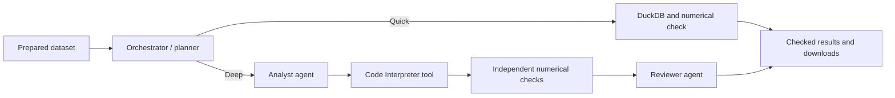

# Product experience v2 — Decision Layer analytics

October 31, 2026. Mode: portfolio moving toward public-product readiness.
Status: historical design proposal, retained alongside the delivery and validation records.
Public guest admission and production launch remain separate release decisions.

Implementation update: the core development experience has shipped. See
[delivery record](product-experience-v2-delivery.md) and
[current status](../implementation-status.md). Public guest admission/self-signup
and production launch remain gated; the historical proposal below is retained.

## User direction

- Eventually host the app on a decision-layer.com subdomain.
- Allow a useful anonymous trial, then require sign-in to continue. Candidate
  limits mentioned: 100,000 tokens or five messages; exact policy is not settled.
- Produce more than one visual when the analytical question warrants it.
- Rich chart interactions, tooltips and a few selectable color combinations.
- A live orchestrator/agent activity visualization highlighting actual work.
- Download visualization code, Python ML code and other useful artifacts.
- Add speech-to-text and streaming; identify other high-value improvements.
- Explain analytical methodologies and when to use them as an optional learning
  experience; suggest suitable analyses after automatic data profiling.
- Plan logging, monitoring and an operational dashboard alongside product work.

## Initial verified implementation before v2

The browser uses custom SVG in static/workspace.js: one chart per result,
native point-title hover labels, fixed colors and an exact-value table. The
managed Code Interpreter has live-tested Plotly 5.22.0, but Plotly does not power
the current browser charts. The primary evidence download is full run JSON with
executed code and support files embedded; there are no curated code/notebook ZIPs.

All hosted workspace routes currently require Cognito access. Self-signup is
administrator-only. Stage strings are coarse and the client polls workspace state
once a second while work is active. The Python Lambda gateway reads the entire
AgentCore response before returning JSON. Speech input and end-to-end browser
streaming are not implemented.

Preparation already saves field roles/types/units, row count, missing counts,
distinct counts, date/numeric ranges, duplicate count and warnings. Upload does
not currently return analysis suggestions. There is no methodology learning
catalog. Additional time-coverage, grain and eligibility checks are needed before
recommending a forecast from a date/measure pair.

Runs save coarse stages, plan/evidence, per-role model token usage and end-to-end
timing. Forecast audit artifacts include execution and independent checks.
Gateway dependency errors are sanitized, but runtime exception handlers still
log exception text/tracebacks; redaction needs review before broader exposure.
The application's current `trace_id` is its run ID, not proof of a distributed
OTEL trace. The reviewed stack generators do not define an application monitoring
dashboard, custom business metrics or alarms. This is a source/configuration
assessment, not an audit of every dashboard already present in the AWS account.

The public Route 53 zone for decision-layer.com is present in the existing AWS
account, verified read-only during the preceding planning pass. No
record/certificate was changed.

## Recommended choices

### Plotly for analytical figures

Use Plotly.js in the browser and Python Plotly for portable visualization code.
One validated figure specification should drive interactive rendering, theme
selection and exports. Pin a tested Python/JavaScript combination; the managed
sandbox's existing version must not be assumed compatible with every latest JS
bundle. Self-host the browser bundle through the existing static deployment.

Return a typed visuals/artifacts list rather than a single fixed chart field.
Each figure carries title, business purpose, exact source/split lineage, units,
kind and an artifact reference. Retain existing results through a renderer adapter.
Allow reviewed statistical chart types and safe layout fields, not arbitrary
model-produced browser JavaScript or network URLs. Downsample only display data;
retain exact values and disclose aggregation. Avoid stuffing large figures into
polling responses; the existing 2 MiB transport bounds remain.

Use two to four complementary views when useful, rather than a compulsory chart
count. A forecast can include history/future values, held-out actual versus
predicted, and validation-error comparison. Model comparison must use validation
metrics; do not turn the final test into another model-selection set. Do not add
prediction bands until uncertainty is supported and checked.

Initial chart palettes: Decision Layer teal/gold, ocean blue/teal, plum/amber and
an accessibility-tested blue/orange option. Apply a palette consistently across
figures and exports. Preserve category meanings, adequate contrast, line patterns
and labels. Changing presentation must not rerun analysis or consume trial usage.

### Methodology explanations as part of the analysis

Add a concise "How this works" explanation beside each analysis and an optional
expandable learning panel. Users can continue asking business questions without
choosing an algorithm or completing a lesson. Include:

- What question the method answers, in plain language, with a small illustrative
  example clearly distinguished from the user's actual results.
- When it is useful, its data requirements, assumptions and when to avoid it.
- Why it was considered for this dataset and, after execution, why it was chosen
  or rejected. Separate a candidate method from a method actually run.
- How it was checked, how to read the metric, limitations and a sensible next
  question. Link the executed code and relevant technical references.

Use a reviewed, versioned method catalog keyed to recipe/method IDs. Keep general
teaching copy deterministic; bind dataset-specific claims to saved profile,
validated plan and checked results. Optional model wording must preserve those
facts. Include the explanation version in exports so a saved report remains
understandable after the catalog changes. Do not expose hidden reasoning.

Start with the methods actually available in the hosted workflow:

| Method/concept | Learning explanation and appropriate use |
|---|---|
| Monthly aggregation | Summarizes a measure over calendar months. Useful for describing history when summation matches the business meaning; summing rates, percentages, balances or mixed currencies can mislead. |
| Naive forecast | Carries the last observed monthly value forward. A simple baseline for asking whether a fitted model improves on persistence; it does not model trend or seasonality. |
| Damped Holt trend | Smooths a changing level and trend, with the extrapolated trend gradually damped. A candidate when monthly history supports a trend; the current recipe has no seasonal component and sudden changes can invalidate extrapolation. |
| Linear trend | Fits a straight trend over time. A candidate for an approximately steady change; extrapolation can fail when growth bends or conditions change. |
| Chronological validation and test | Earlier periods train, the next period selects a method, and the untouched final period evaluates it. Explain why future data must not leak into the past. |
| Mean absolute error (MAE) | Average absolute prediction error in the measure's units; smaller is better on the same held-out observations. Compare with the baseline, not unrelated datasets or training error. |

Verify this teaching copy against the actual recipe before publication. Broader
catalog entries can cover distributions, group comparisons, anomaly detection,
regression, classification, clustering and experiment analysis as those recipes
become available. Clearly mark future capabilities; a numeric column alone does
not establish a valid prediction target, independent observations or causality.

### Suggested analyses after profiling

Preferred flow: upload -> automatic preparation -> data-readiness summary ->
two to four suitable analysis cards -> user starts one or asks a question.
When upload accompanies a specific question, prioritize that requested analysis;
recommendations must not become an extra mandatory screen.

Each card should contain a business question, a short "why this fits your data,"
the expected output, an indication of fast summary versus deeper modeling, and
a link to its methodology explanation. Infer technical field mappings internally.
Offer natural business clarification only when meaning is materially ambiguous,
for example "Should revenue use order date or payment date?" Do not require
column selection. Show assumptions and allow a plain-language correction.

Start with deterministic, capability-aware eligibility rules over the profile
and bounded preparation diagnostics. Check the actual recipe prerequisites,
usable observation count, monthly coverage/gaps, duplicate/grain issues, units
and missingness. Fail closed when these cannot be established. An agent may
rank or phrase eligible cards using business context; it cannot bypass checks
or invent unsupported analysis types. Reuse recommendations for an immutable
dataset/profile and capability version; no mandatory extra model call per upload.

For the current hosted date/revenue example, possible cards are "How has monthly
revenue changed?" and, only if the history passes forecast eligibility, "What
could the next three months look like?" Category comparisons and other methods
must wait for their corresponding hosted recipes. If there is too little history,
explain the missing requirement and offer a supported descriptive analysis.
Do not fill a card quota with ineligible work or generate forecasts automatically.

Viewing suggestions, learning panels or changing chart themes consumes no analysis
credit. Reserve usage only after an explicit analysis submission. Revalidate
dataset ownership/version, capability and quota at submission; a suggestion is
not permission to execute. Suggestions should describe questions worth testing,
not claim insights before an analysis has run.

### Guest trial with an account transition

Recommended first experiment: up to five completed analyses per guest, with
server-side token, interpreter-time, audio and rate limits as additional controls.
100,000 aggregate model tokens is a candidate internal ceiling, not an agreed
public promise or spend cap. The small live forecast used 4,899 tokens across its
roles; token allowance and user-message allowance are not equivalent.

Count one human analysis request once. Planner/analyst/reviewer calls, multiple
charts, status events and streamed chunks do not count as separate questions.
Do not consume an analysis credit for clarification or a confirmed system failure;
retain token/compute accounting for the actual work. Unknown execution outcomes
require reconciliation before automatically releasing reservations.

Create an opaque server-issued guest session, bound to an isolated workspace;
never trust a client-provided owner or client-side counter. Reserve quota with a
conditional/transactional server operation before work begins and reconcile usage
across every role, code repair, retry and tool. Limit new submissions, while
allowing the fifth run to finish, its evidence to download and cancellation to
work. Show remaining analyses before submission and a clear sign-in gate.

Bind and claim guest work during verified login without losing files, history or
results. Use an atomic workspace-ownership/authorization mapping; do not let a
caller name another guest workspace or copy another user's namespace. Existing
owner-hash namespaces need a deliberate compatibility/merge path. Enable and test
self-service account registration/verification, since the current pool is
administrator-only. Logged-in users also need an explicit allowance.

Cookie resets and automated account creation can bypass a simplistic trial.
Combine session/account limits with privacy-conscious IP/edge backstops and a
global daily admission/spend guard. Tokens alone do not bound Interpreter,
Transcribe, gateway or storage cost. Public quotas are separate from the $10
initial development/test authorization and must precede an anonymous launch.

### Activity map driven by real execution events

Show the orchestrator and the chosen path. Agent nodes and tools should be
visually distinct. Preparation is saved/reused, not re-run theatrically for each
question. Quick jobs bypass deep-analysis and reviewer stages.

Emit structured started/completed/failed/skipped/cancelled events with run ID,
stage/role/tool ID, timestamp and monotonic sequence. Track attempts explicitly.
Persist events so the client can reconnect/replay without starting another job.
The current execution-stage label starts before the analyst, so it cannot be
used as the authoritative active-agent event without instrumentation changes.

The active node highlights; completed nodes get check marks; queued/skipped/error
states have text and shape cues as well as color. Show elapsed time and a concise
user-facing description. Honor reduced motion and keep a text status alternative.
Use SVG/CSS for the small workflow diagram; Plotly serves analytical figures.
Show progress summaries and checked findings, not private chain-of-thought or raw
unvalidated tool output. Avoid fabricated percentages or forced execution delays.

### Streaming and speech

First add real stage events and reconnectable progress; then stream approved
answer sections and publish each figure when its checks pass. Stream consumption
must never itself trigger a new analysis or count another user message.

AgentCore supports streaming, but the existing Python gateway buffers the response.
Preserve end-to-end streaming through an authenticated fetch/SSE transport, with
heartbeats, event IDs, cancellation and bounded connection duration. Do not put
user bearer tokens in URLs. Python Lambda streaming needs a streaming-capable
adapter/custom runtime, or a small native Node streaming endpoint can sit beside
the existing control API. Choose after a bounded transport proof; retain persisted
job state as the source of truth. A disconnected client does not automatically
cancel billable Lambda/agent execution, so cancellation must be explicit.

Speech v1: push-to-talk -> Amazon Transcribe streaming -> editable transcript ->
Send. Only a submitted question reserves an analysis credit. Partial transcripts
are draft text and must not launch jobs. Show microphone state, stop/cancel and
permission errors. Bound audio duration/usage and avoid retaining audio in app
storage by default. Use a supported PCM/Opus container/encoding path, not an
assumption that every browser MediaRecorder format is accepted. Spoken answers
and full voice conversation can follow separately.

### Curated downloads

Offer individually and as an analysis bundle:

- Interactive chart HTML, PNG/SVG and validated figure JSON.
- Python visualization code and optional JavaScript rendering code.
- Exact ML/analysis code plus all support modules; do not export only a wrapper
  that imports an absent recipe module.
- A readable notebook, SQL/transform steps, source/feature definitions and exact
  chart/prediction/metric CSVs.
- Dependency versions, plan, seeds, train/validation/test contract, hashes,
  review results and a short reproduction README.

Preserve the selected visual theme and exact executed lineage. Make inclusion of
original uploaded data explicit; default to the minimum necessary result data.
Store generated artifacts separately in private S3 and serve owner-authorized,
short-lived downloads. HTML/ZIP can exceed the current 2 MiB response limit, so
return an authorized artifact manifest instead of base64 payloads through Lambda.
Do not include credentials, signed URLs, private internal reasoning or unrelated
workspace files. An exported notebook's source should match the executed recipe.

### Branded subdomain

Proposed label: analyst.decision-layer.com; the user has not finalized it.
Use the current CloudFront distribution, an ACM certificate in us-east-1 and
Route 53 aliases. Update Cognito callback/logout URLs, upload CORS, application
origin configuration and tests together. Preserve the main website and stage
before DNS cutover; verify cookies/PKCE/reconnect and artifact downloads at the
new origin. The auth host can remain the existing Cognito host initially.

## Other product improvements

1. A plain-language decision summary: finding, supporting evidence, limitations
   and a sensible next investigation, with causal claims gated by study design.
2. Natural follow-ups over the same version, with period/segment comparisons and
   explicit assumption corrections preserved as plan revisions.
3. A compact data-readiness view explaining inferred grain, coverage, units,
   missingness and partial-period assumptions before an expensive analysis.
4. Broader cloud recipes, seasonal/backtesting support and calibrated uncertainty
   where justified; regression/classification currently remain local-only.
5. Saved projects/history, transparent retention/deletion, sample datasets and
   accessible chart tables alongside interactive views.
6. Quality regression cases covering ambiguous exports, leakage, quota races,
   stream reconnects, failed jobs and numerical agreement across every visual.

## Delivery order and acceptance

A. Visuals/themes/downloads: multiple appropriate Plotly figures from verified
results, hover/zoom/legend behavior, theme persistence, equivalent exported data,
reproducible code/notebook and safe owner-scoped downloads. Preserve old runs.

B. Activity/streaming: actual per-agent/tool events, correct quick/deep paths,
partial availability after checks, reconnect without rerun, explicit cancellation
and no hidden-reasoning leakage. Verify the real hosted streaming path, not just
an SDK stream consumed into buffered JSON.

C. Guest/public launch: server-enforced trial and global limits, atomic quota
reservation, data claim on signup/login, self-service onboarding, domain/TLS/
callback/CORS acceptance and a reviewed production launch. Resolve remaining image
findings or complete an explicit risk review before public production exposure.

D. Speech: bounded push-to-talk with editable partial/final text, tested browser
encoding support, cancellation and measured audio/model usage.

Production request-rate/MFA/revocation policy, durable artifact retention/job
recovery and reconciled billing remain part of launch readiness. This proposal
does not silently increase the authorized cloud-spend scope.

## Logging, monitoring and the operator dashboard

Build observability with the activity-event work and before the guest launch.
Use the native AgentCore/CloudWatch views first, then add a small private
CloudWatch application dashboard and saved Logs Insights queries. AWS documents
built-in AgentCore metrics and OTEL instrumentation for richer spans/traces;
application-level success and analytical correctness still need explicit events.
Keep any later in-app admin view authenticated and separately authorized. Normal
users see only their own activity and allowance, never account-wide telemetry.

### Shared event contract and correlation

Use one canonical set of server-side workflow events for replayable user progress,
structured operational logging and trace spans. Give events an ID, sequence,
timestamp, environment/release, operation, role/tool, attempt, status, duration and
safe error code. Correlate upload/profile, submitted run, agent calls, Interpreter,
checks, artifact publication and cleanup using opaque dataset/run IDs, AWS request
IDs and real trace/span IDs when tracing is enabled. Background jobs and polling
requests need explicit correlation; one HTTP trace is not automatically the full
analysis lifecycle. Do not label the existing run ID as a real OTEL trace ID.

Persist correctness-critical job/quota state independently of best-effort telemetry.
Deduplicate event retries for run-level outcome counts and count internal attempts
separately. CloudWatch metric/log delivery must not become a quota ledger or a
reason to rerun an analysis. Store a sanitized public projection for the activity
map rather than returning internal logs to the browser.

### Initial dashboard

| View | Initial signals and purpose |
|---|---|
| Reliability | Completed, failed, cancelled and clarification-required analyses; terminal success rate; upload/profile failures; HTTP errors/throttles; active jobs and stale leases. Polling requests are not analysis completions. |
| Speed and workflow | End-to-end and per-stage p50/p95 duration with sample counts; planner/analyst/reviewer/Interpreter latency, retries and timeouts; cleanup failures and sessions awaiting stop confirmation. Add time to first useful event/result when streaming exists. |
| Analytical quality | Numerical-check failures, reviewer rejections, unsupported-task attempts and forecast error versus the baseline on matching test windows. Keep numerical agreement distinct from predictive quality and prose-review acceptance. Never combine unlike metric scales into one accuracy score. |
| Usage and cost | Input/output tokens by role/model, Interpreter/runtime duration, analysis admission/limits and later audio seconds; estimated cost per completed analysis plus failed/cancelled work. Show estimate timestamp/coverage and reconcile with authoritative AWS billing. |
| Product and readiness | Upload-to-first-success funnel, suggestion selection, clarification/abandonment, download success and later trial-to-signup conversion. Prefer minimal aggregate events and document any identity/session linking. |

Instrument both quick and deep workflows. Include failed attempts whose usage is
available; mark unknown token/compute amounts as unknown rather than zero. Current
model tracking is a starting point, not complete billing evidence. AWS resource
usage telemetry can be delayed and differ from reconciled charges. Account-level
service metrics can include other agents, so scope the view to these development
resources wherever supported.

### Privacy, alerts and cost controls

- Allowlist metadata in logs and span attributes. Exclude raw uploads/rows,
  prompts, responses, code, tool payloads, filenames/column values, email,
  tokens, presigned URLs and hidden reasoning. Sanitize exception messages,
  stack traces and SDK/auto-instrumentation payload capture too. Full analytical
  evidence belongs in the existing private, owner-scoped artifact store under
  its retention policy, not copied wholesale into operational logs.
- Keep run/user/session IDs in restricted logs or trace attributes, never custom
  metric dimensions. Use a small bounded set such as environment, operation,
  stage and outcome. Avoid unnecessary dimension combinations and high-resolution
  metrics; CloudWatch warns that high cardinality increases custom metric cost.
- Preserve bounded development retention; explicitly configure any new span/log
  destinations, access and deletion behavior. Start with service metrics,
  structured summaries and limited trace sampling after verifying payload capture.
  Treat telemetry access as a separate operator privilege.
- Add actionable alarms for repeated job failures/timeouts, jobs past their
  execution deadline plus cleanup grace, Interpreter stop failures, throttling
  and anomalous usage/admission pressure. Each alarm needs an owner, threshold,
  minimum sample/window, missing-data behavior and a short response playbook.
  No traffic must not appear as a healthy success-rate sample. Choose notification
  channels before wiring outbound alerts; do not subscribe an email implicitly.
- Reuse quota enforcement for an application admission stop. Billing/budget
  alerts and dashboards are delayed monitoring aids, not a real-time hard spend
  cap. Account for log ingestion, query scans, traces, metrics and alarms in the
  development allowance before enabling continuously billable telemetry.

### Acceptance and sequencing additions

1. Learning and recommendations accompany slice A: reviewed explanations for all
   executed methods; eligible cards reference the correct dataset; too-short,
   ambiguous, missing/gapped and unsupported inputs get appropriate alternatives
   or business clarification; no required technical field mapping; no quota or
   model charge merely for opening deterministic teaching/suggestion content.
2. Instrumentation and the initial operator dashboard accompany slice B, before
   slice C's anonymous exposure. A bounded hosted quick run and deep run must
   correlate from submission to completion; exercise a safe failed/cancelled job,
   reconnect and cleanup without duplicate execution or misleading counts.
3. Check emitted telemetry using synthetic sensitive markers: logs/traces must
   exclude source/prompt/token content, including failures. Validate that the
   user view is owner-scoped and the operator view needs distinct authorization.
4. Confirm dashboard data sources, counts, units, latency samples, unknown usage,
   retention and incremental telemetry cost. Verify alarms and their runbooks
   using bounded synthetic signals. Notification delivery is a separate check
   after an explicit channel choice; no dashboard or alarm was deployed here.

## Primary references checked

- https://plotly.com/javascript/hover-text-and-formatting/
- https://plotly.com/javascript/configuration-options/
- https://plotly.com/python/interactive-html-export/
- https://plotly.com/javascript/colorscales/
- https://docs.aws.amazon.com/bedrock-agentcore/latest/devguide/response-streaming.html
- https://docs.aws.amazon.com/lambda/latest/dg/configuration-response-streaming.html
- https://docs.aws.amazon.com/transcribe/latest/dg/streaming-partial-results.html
- https://docs.aws.amazon.com/AmazonCloudFront/latest/DeveloperGuide/cnames-and-https-requirements.html
- https://docs.aws.amazon.com/bedrock-agentcore/latest/devguide/observability.html
- https://docs.aws.amazon.com/bedrock-agentcore/latest/devguide/observability-configure.html
- https://docs.aws.amazon.com/bedrock-agentcore/latest/devguide/observability-runtime-metrics.html
- https://docs.aws.amazon.com/AmazonCloudWatch/latest/monitoring/CloudWatch_Dashboards.html
- https://docs.aws.amazon.com/AmazonCloudWatch/latest/monitoring/CloudWatch_Embedded_Metric_Format_Specification.html
