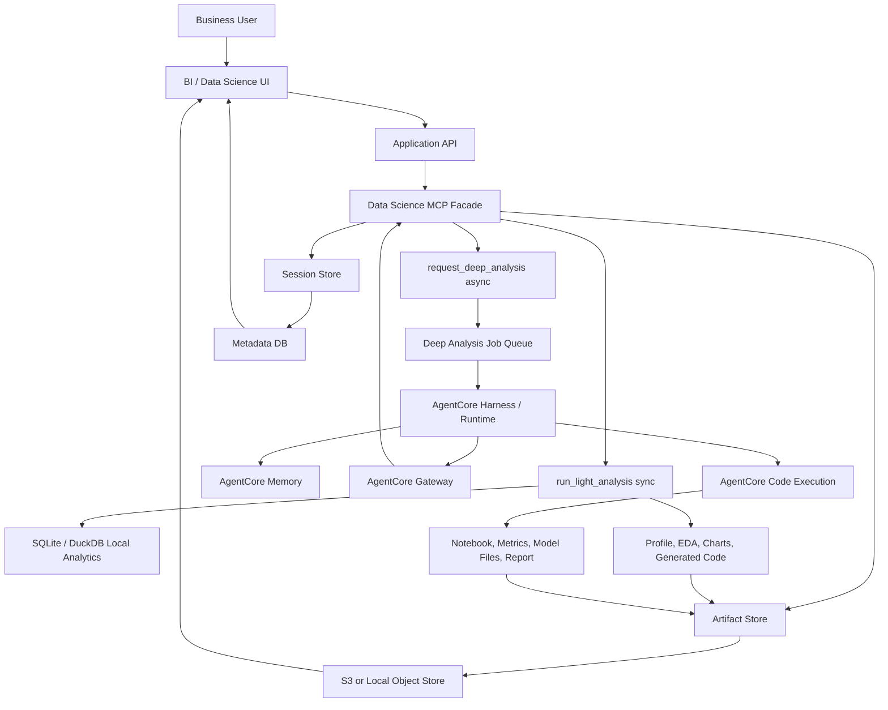

# Virtual Data Scientist AgentCore Architecture

Status: AgentCore runtime and authenticated backend deployed
Date: 2026-07-05
Project mode: prototype moving toward portfolio and productionization

## Purpose

This design extends the AI-native BI report platform into a virtual data
scientist: a user uploads or connects data, asks a business question, receives a
fast light analysis immediately, and can request a deeper asynchronous analysis
handled by AWS AgentCore agents with code execution.

The product problem is not just "run a model." The product problem is helping a
business user decide what analytical technique fits the question, execute it
reproducibly, and preserve enough context for iteration across sessions.

## Current Baseline

The local POC already has useful foundations:

- Python standard-library server in `server.py`.
- SQLite demo warehouse and local CSV upload into queryable tables.
- Deployed S3-backed CSV upload through the authenticated Lambda backend.
- Optional Bedrock, Postgres, and S3 adapters.
- Schema browser, report drafting, SQL preview, and publish flow.
- SELECT-only SQL preview with bound parameters and row limits.
- Local fallback when cloud services are not configured.
- Deployed AgentCore Runtime:
  - stack `AgentCore-vdsagentcore-default`
  - runtime `VirtualDataScientistAgent`
  - ARN
    `arn:aws:bedrock-agentcore:us-east-1:441383083571:runtime/vdsagentcore_VirtualDataScientistAgent-iSOiop5y80`
  - deployment target `default` in account `441383083571`, region `us-east-1`
- Deployed authenticated backend:
  - stack `VirtualDataScientistBackend-dev`
  - Lambda `virtual-data-scientist-backend-dev`
  - Function URL
    `https://fdzrbtz4sewn6nrnlnbgbykbpu0jcutl.lambda-url.us-east-1.on.aws/`
  - auth type `AWS_IAM`
  - S3 analysis state bucket
    `virtualdatascientistbacke-analysisstatebucket24530-zbt8jnot9lld`
- Runtime env:
  - `DATA_SCIENCE_MCP_BASE_URL` points to the backend Function URL
  - `DATA_SCIENCE_MCP_AUTH_MODE=aws_iam`

The deployed runtime accepts invocations and can call the authenticated backend.
The latest deployed smoke test uploaded a CSV through the consulting website
bridge, registered S3-backed data source `csv_771802e9d1fb`, invoked AgentCore
against that uploaded source, created analysis session `sess_6077c3b25f2d`, ran
light analysis `run_8d5803f0b5ca`, and persisted profile/code/report artifacts.

The new architecture should reuse that baseline instead of replacing it with
AgentCore upfront.

## Design Thesis

Use the MCP layer as a stable product facade, not as the whole data scientist.

- The MCP facade exposes a small set of durable operations.
- Light analysis runs synchronously and returns quick, deterministic insight.
- Deep analysis is an asynchronous job handed to an AgentCore agent session.
- AgentCore handles the long-running agent harness, memory, tools, code
  execution, traces, and later evaluations.
- The application database and artifact store remain the source of truth for
  reproducibility.

Do not make `run_deep_analysis` a blocking tool. The user should get a run id,
status, and progressive artifacts rather than waiting on a long agent session.

## Target Architecture



## Public MCP Tool Contract

Keep the first MCP surface intentionally small:

```text
create_analysis_session(user_goal, dataset_refs?, constraints?)
upload_dataset(session_id, file, metadata?)
run_light_analysis(session_id, dataset_id, user_question?)
request_deep_analysis(session_id, dataset_id, user_question, constraints?)
get_analysis_status(session_id, run_id)
get_analysis_artifacts(session_id, run_id?)
continue_analysis(session_id, message, selected_artifact_ids?)
```

The internal implementation can use many helpers, but the externally visible
tool contract should stay narrow. This keeps the product API stable while the
analysis engine improves.

## Light Analysis

Light analysis should return in seconds. It should be predictable, bounded, and
cheap.

Initial scope:

- Dataset fingerprint, row count, column count, file size, and schema.
- Column type inference.
- Missingness and cardinality.
- Numeric summaries and simple outlier flags.
- Categorical frequency summaries.
- Date/time column detection.
- Target-column guesses and likely problem types.
- Correlation scan for numeric columns.
- Basic quality warnings.
- Generated Python or SQL code used for the analysis.
- Plain-English "what this data appears suitable for" summary.

Light analysis should not train heavy models. It can produce baselines only if
they are cheap and clearly marked as exploratory.

## Deep Analysis

Deep analysis should be an asynchronous AgentCore job. It can take minutes or
longer and should emit progress artifacts.

Initial scope:

- EDA expansion.
- Regression and classification baselines.
- Forecasting with time-aware validation.
- Clustering and segmentation.
- Anomaly detection.
- Text summary, topic, or classification workflows when text fields exist.
- Leakage checks.
- Metric selection.
- Feature engineering.
- Model comparison when justified.
- Final analytical report.
- Reproducible code bundle.

The local worker now covers a dependency-light subset of this scope before
AgentCore deployment: naive forecast holdout diagnostics, class balance and
majority-class baselines, numeric correlation and grouped driver summaries,
segment profiles, numeric outlier scans, and basic text term/length summaries.
Those outputs are saved under `baseline_diagnostics` in the deep-analysis report
artifact. They are exploratory diagnostics, not production model training.

The deep-analysis agent should be instructed to say "ML is not useful here" when
the question is better answered by SQL, descriptive statistics, or missing data
collection.

## Analysis Context Bundle

Every deep-analysis handoff should pass references plus generated context, not a
large raw data dump in the prompt.

```json
{
  "session_id": "sess_123",
  "dataset_id": "ds_456",
  "dataset_uri": "s3://bucket/workspaces/ws_1/datasets/ds_456/input.csv",
  "dataset_fingerprint": "sha256:...",
  "user_question": "What drives churn?",
  "light_analysis_report_id": "artifact_light_report_001",
  "light_analysis_code_id": "artifact_light_code_001",
  "schema_profile_id": "artifact_schema_001",
  "prior_run_ids": ["run_001"],
  "constraints": {
    "max_runtime_minutes": 30,
    "privacy_mode": "registered_dataset_only",
    "allowed_analysis_types": ["eda", "classification", "regression"]
  }
}
```

The bundle must always include the light-analysis code and result artifacts. That
keeps the deep agent grounded in what was already observed and lets a future
agent rerun or critique the first pass.

## Persistence Model

Use three distinct forms of memory.

### Application Source Of Truth

The app owns durable, auditable state:

- Workspaces and users.
- Analysis sessions.
- Dataset records and versions.
- Dataset fingerprints and storage URIs.
- Light-analysis runs.
- Deep-analysis runs.
- Artifact manifests.
- Generated code files.
- Reports and report versions.
- Audit events.

This should live in Postgres for production and SQLite for local development.

### Object And Artifact Store

Use S3 in production and local files in the POC:

- Uploaded datasets.
- Derived profile JSON.
- Generated notebooks or Python scripts.
- Charts and images.
- Model metrics.
- Final reports.
- Logs that are safe to expose to users.

### AgentCore Memory

Use AgentCore Memory for agent continuity:

- User preferences.
- Business context.
- Prior clarifying answers.
- Session summaries.
- Reusable analysis assumptions.

Do not rely on AgentCore Memory as the only record of analytical work. Agent
memory improves continuity; the application store proves reproducibility.

## Data Model Additions

The existing report data model should be extended with analysis-specific tables.

```text
analysis_sessions
  id
  workspace_id
  owner_user_id
  title
  current_dataset_id
  user_goal
  status
  created_at
  updated_at

datasets
  id
  workspace_id
  source_type
  display_name
  storage_uri
  fingerprint
  row_count
  column_count
  schema_json
  created_at

analysis_runs
  id
  session_id
  dataset_id
  run_type              -- light, deep
  status                -- queued, running, succeeded, failed, cancelled
  user_question
  selected_analysis_type
  agentcore_session_id
  started_at
  finished_at
  error_message

analysis_artifacts
  id
  run_id
  artifact_type         -- profile, code, chart, report, notebook, model_metrics
  title
  storage_uri
  content_type
  summary
  created_at

analysis_messages
  id
  session_id
  actor                 -- user, app, agent, system
  message_text
  related_run_id
  created_at

analysis_audit_events
  id
  workspace_id
  actor_user_id
  event_type
  session_id
  dataset_id
  run_id
  details_json
  created_at
```

## AgentCore Placement

Use the current AgentCore CLI path for new work, not the legacy Python starter
toolkit. The starter toolkit remains useful as background, but AWS now
recommends the AgentCore CLI for creating, developing, and deploying new
AgentCore agents.

Suggested project layout:

```text
virtual-data-scientist/
  analysis_engine/
    light_analysis.py
    method_catalog.py
    context_bundle.py
    artifact_store.py
    session_store.py
  mcp_server/
    server.py
    tools.py
  agentcore/
    agentcore.json
    aws-targets.json
    cdk/
  app/
    VirtualDataScientistAgent/
      main.py
      pyproject.toml
      prompts/
        system.md
        deep_analysis_workflow.md
```

For the first production-shaped prototype, the AgentCore path runs locally:

```text
request_deep_analysis -> create queued analysis_run -> dependency-light local worker
```

Then replace the worker with AgentCore once the light-analysis artifacts, session
state, and context bundle are stable.

## Production Stack Design

Each layer includes the current choice or missing decision, production target,
validation needed, risk if skipped, and a deferrable shortcut.

### 1. Frontend Foundations

- Current: vanilla HTML/CSS/JS report workbench.
- Production target: React or Next.js application with routes for data upload,
  session chat, light-analysis results, deep-run status, artifacts, and published
  reports.
- Validation: browser checks for upload, analysis request, status refresh,
  artifact preview, responsive layout, keyboard navigation, and error states.
- Risk if skipped: the agent workflow becomes hard to inspect and users cannot
  trust long-running analysis progress.
- Deferrable shortcut: keep current vanilla UI but add explicit analysis session,
  light result, and deep run status panels.

### 2. APIs And Backend Logic

- Current: single `server.py` with local endpoints for schema, draft report,
  preview, publish, Postgres test/save, and CSV upload.
- Production target: versioned API layer with explicit contracts for sessions,
  datasets, light runs, deep runs, artifact retrieval, report publishing, and
  status polling or events.
- Validation: endpoint tests for idempotent upload/session creation, input
  validation, SELECT-only preview, job state transitions, and artifact retrieval.
- Risk if skipped: analysis jobs become unreproducible and difficult to resume.
- Deferrable shortcut: add analysis endpoints to the current server before
  extracting FastAPI or another framework.

### 3. Database And Storage

- Current: SQLite demo warehouse and `data/reports.json`; optional raw S3 CSV
  upload.
- Production target: Postgres metadata store plus S3 object storage for datasets,
  derived artifacts, code, notebooks, charts, and report versions. Use DuckDB for
  local file analytics and Athena/Glue only after governance is clear.
- Validation: migration tests, dataset fingerprint tests, artifact manifest
  round trip, backup/restore drill, and local seed data.
- Risk if skipped: users cannot continue across sessions, rerun analysis, or
  audit what code produced a result.
- Deferrable shortcut: SQLite tables plus local artifact files, with schema
  matching the future Postgres model.

### 4. Auth And Permissions

- Current: no auth in local POC.
- Production target: Cognito or existing enterprise IdP, workspace membership,
  owner/viewer/admin roles, service accounts for agents, and per-workspace
  dataset/report access checks.
- Validation: authorization tests across workspace boundaries, viewer vs author
  permissions, and service-account tool access.
- Risk if skipped: users can see or analyze datasets they should not access.
- Deferrable shortcut: single-user local mode with an explicit "not production
  auth" banner and hardcoded workspace id.

### 5. Hosting And Deploy

- Current: local Python server.
- Production target: separated dev/stage/prod environments; frontend on Amplify
  or CloudFront/S3; backend on ECS/Fargate, App Runner, or Lambda depending on
  runtime needs; TLS and domain ownership; rollback plan.
- Validation: build, package, smoke test, config validation, and rollback drill.
- Risk if skipped: the demo cannot become a reliable portfolio or internal
  product deployment.
- Deferrable shortcut: keep local-only until the data/session model is stable;
  create CDK synth before any deploy.

### 6. Cloud And Compute

- Current: optional Bedrock/Postgres/S3 integrations, no background worker.
- Production target: synchronous app API for light analysis; async worker queue
  for deep analysis; AgentCore Harness/Runtime for long-running agent sessions;
  AgentCore Gateway for controlled MCP/tool access; AgentCore Memory for
  session continuity; AgentCore Observability for traces.
- Validation: local worker test, queued job retry test, AgentCore local dev
  invocation, deployed invoke test, timeout and cancellation tests.
- Risk if skipped: deep analysis blocks users and long jobs fail invisibly.
- Deferrable shortcut: implement a local background worker before wiring
  AgentCore.

### 7. CI/CD And Version Control

- Current: no visible CI in the POC.
- Production target: PR checks for Python tests, frontend tests, linting, static
  analysis, config validation, package build, and CDK synth when infra exists.
- Validation: CI green on a seeded local test suite.
- Risk if skipped: agent/tool changes can silently break safety controls.
- Deferrable shortcut: add a local `make test` or `python -m unittest` target
  before full CI.

### 8. Security And RLS

- Current: SELECT-only SQL validation and bound parameters; no tenant isolation.
- Production target: threat model, tenant/workspace isolation, read-only data
  connectors, secret references only, least-privilege IAM, sensitive-column
  policy checks, audit logs, and eventually database-enforced row-level security
  or equivalent entitlement model.
- Validation: security tests for cross-workspace access, non-SELECT rejection,
  secret non-persistence, prompt/tool policy denial, and audit-event coverage.
- Risk if skipped: the product can leak private data or produce reports using
  unauthorized sources.
- Deferrable shortcut: use demo data and single-user local mode, but keep every
  persisted record workspace-scoped.

### 9. Rate Limiting

- Current: no rate limits.
- Production target: per-user, per-workspace, per-endpoint, and per-analysis-run
  limits; hard caps for dataset size, execution time, generated artifacts, model
  calls, and AgentCore runtime duration.
- Validation: tests for quota rejection, retry-after messaging, and expensive
  deep-analysis throttling.
- Risk if skipped: one user can trigger runaway model/runtime cost.
- Deferrable shortcut: local max file size, max rows sampled, and max deep-run
  minutes.

### 10. Caching And CDN

- Current: static local assets and stored published report JSON.
- Production target: CDN for static assets and published report shells; private
  artifact URLs with signed access; cached light-analysis profiles by dataset
  fingerprint; explicit invalidation on dataset version change.
- Validation: cache-key tests, private artifact access tests, and stale-profile
  invalidation tests.
- Risk if skipped: stale or private results can be shown to the wrong user.
- Deferrable shortcut: local cache by dataset fingerprint with no shared CDN.

### 11. Load Balancing And Scaling

- Current: single local process.
- Production target: stateless API nodes, connection pooling, separate workers,
  queue backpressure, autoscaling based on queue depth and API latency, and
  graceful degradation from deep analysis to light-only mode.
- Validation: concurrent upload/run tests, queue backpressure tests, worker
  restart recovery, and connection pool limits.
- Risk if skipped: long analyses can starve normal report and upload traffic.
- Deferrable shortcut: one local worker and one API process, but keep deep jobs
  asynchronous.

### 12. Load Tracking And Logs

- Current: limited local server output.
- Production target: structured logs with request id, session id, dataset id,
  run id, user/workspace id, model/tool calls, code-execution duration, query
  duration, token/runtime cost, and artifact writes. Use CloudWatch plus
  AgentCore traces once deployed.
- Validation: log shape tests, trace lookup for a sample deep run, dashboard
  checks, and alert dry runs.
- Risk if skipped: analysis failures and cost spikes become impossible to debug.
- Deferrable shortcut: write JSONL audit/run logs locally for every analysis
  transition.

### 13. Availability And Recovery

- Current: local demo only; no backups or restore path.
- Production target: defined SLO for app availability, health checks, metadata
  backups, artifact lifecycle policies, restore drills, failed-run recovery,
  dataset export path, and dependency outage plan for Bedrock/AgentCore/S3/RDS.
- Validation: restore drill, failed AgentCore run replay, object existence check,
  and local export/import test.
- Risk if skipped: users lose analysis sessions or cannot prove how a conclusion
  was produced.
- Deferrable shortcut: local export bundle per analysis session containing
  metadata JSON, artifacts, code, and report.

## Build Sequence

### Now

1. Add durable architecture and context docs for the virtual data scientist path.
2. Add analysis-session, dataset, run, and artifact records in local storage.
3. Implement `run_light_analysis` locally with generated code artifacts.
4. Add UI panels for light results, deep-run request, status, and artifacts.
5. Add a local async deep-analysis worker that records queued/running/succeeded
   state and stores context, report, and code artifacts.
6. Add a method catalog that maps user intent and data shape to EDA, regression,
   classification, forecasting, clustering, anomaly detection, or "not enough
   data."
7. Add initial leakage, time-split, target-detection, and meaningful-measure
   checks.

### Next

1. Add richer target-quality and metric-choice checks.
2. Add AgentCore CLI project skeleton and local dev invocation.
3. Expose the MCP facade through AgentCore Gateway or an MCP-compatible target.
4. Replace or wrap the local worker with AgentCore once local analysis behavior
   is stable.

### Later

1. Deploy AgentCore deep-analysis agent with Memory, Gateway, Observability, and
   Code execution.
2. Add AgentCore Evaluations for repeated analysis tasks and failure cases.
3. Add production Postgres metadata, S3 artifact storage, and Secrets Manager.
4. Add auth, workspace permissions, and tenant isolation.
5. Add CDK and staged deploy path after local behavior is stable.

### Do Not Build Yet

1. Full AutoML model marketplace.
2. Drag-and-drop BI canvas.
3. Arbitrary user-installed Python packages.
4. Live production data connectors.
5. Broad multi-tenant RLS framework before the single-workspace audit model is
   clean.
6. Athena/Glue automation before dataset/session/artifact lineage works locally.

## Validation Plan

Local validation before AgentCore:

```bash
python3 server.py
```

Manual browser flow:

```text
open workbench
upload or select dataset
run light analysis
inspect generated code artifact
request deep analysis
observe queued/running/succeeded status
open analysis artifacts
continue the session with a follow-up question
publish or export the final report
```

Automated tests to add with implementation:

- Upload creates a dataset record without raw secrets.
- Dataset fingerprint is stable for identical content.
- Light analysis stores profile, summary, warnings, and code artifacts.
- Deep analysis request creates a queued run and returns immediately.
- Status polling returns valid run transitions.
- Continue-analysis loads prior session, run, and artifact context.
- Non-SELECT query execution remains blocked.
- Artifacts are workspace/session scoped.

## Reference Notes

Checked on 2026-07-05:

- AWS AgentCore overview: https://docs.aws.amazon.com/bedrock-agentcore/latest/devguide/what-is-bedrock-agentcore.html
- AWS AgentCore Harness: https://docs.aws.amazon.com/bedrock-agentcore/latest/devguide/harness.html
- AWS AgentCore Memory: https://docs.aws.amazon.com/bedrock-agentcore/latest/devguide/memory.html
- AWS AgentCore Gateway: https://docs.aws.amazon.com/bedrock-agentcore/latest/devguide/gateway.html
- AWS AgentCore CLI: https://github.com/aws/agentcore-cli
- Legacy starter toolkit note: https://github.com/aws/bedrock-agentcore-starter-toolkit