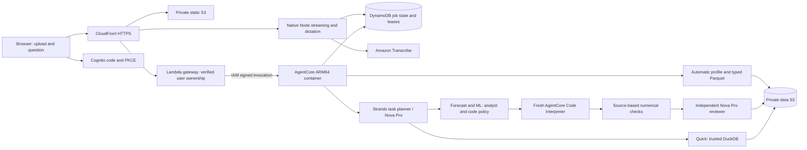

# Virtual Data Scientist project context

Updated November 1, 2026. Mode: productionization of the hosted development preview.
Canonical repository: `/Users/scottleduc/Projects/virtual-data-scientist`.

## ML showcase iteration

The November 1 implementation adds a 42px chat status strip with an optional React Flow map, Plotly.js Cartesian 4.2.0 analytical charts, readable task-specific analysis scripts/notebooks, an eight-snapshot teaching gallery and two reviewed OpenML imports. New regression, classification, clustering, PCA and anomaly routes cross the same AgentCore execution, numerical review and independent model-review boundaries as forecasting. See [implementation plan](docs/plans/ml-showcase-and-exports.md) and [renderer decision](docs/research/visualization-engine.md). 97 Python and 30 JavaScript tests pass. All six methods, two reviewed OpenML imports and browser gallery/login/upload/classification/exports passed on AWS; current evidence is `docs/deployment/2026-11-01-ml-showcase-verification.json`. The current image is release06 / runtime version 22.

## Purpose and verified status

The primary experience is upload + natural-language business question. Users do
not configure technical columns or algorithms. Automatic preparation plus a
checked Strands plan selects the appropriate supported tool.

Separate AWS development stack `VirtualDataScientistV2Dev` is deployed in
account `441383083571`, `us-east-1`, release `dev-20261101-06`. Actual CSV and Excel
chart/forecast runs, narrative review, imports/plot transfer, stopped sessions,
reconnect, owner isolation, cancellation and deletion passed. Current runtime and web outputs are in `docs/deployment/dev-20261101-06.json`;
the earlier `2026-10-31-agentcore-dev.json` remains historical evidence.

The actual HTTPS workspace is https://mlworkbench.decision-layer.com/.
The previous `analyst.decision-layer.com` and original CloudFront URLs remain supported sign-in origins. Sessions and pending drafts are browser-origin scoped; use the old address to finish a draft started there. Account ownership and saved cloud data are unchanged across origins.
A separate `VirtualDataScientistV2DevWeb` stack provides private static S3,
CloudFront, Cognito code/PKCE sign-in and an IAM-only Lambda URL gateway.
The gateway verifies access tokens and derives owner identity; self-service signed-in preview registration is enabled. Hosted Excel upload/chart/forecast, a full 10 MiB upload, identity/origin
isolation, reload/reconnect, evidence download and logout passed. Temporary test
users were removed without sending invitations. The owner account is provisioned and Cognito accepted its email invitation.
First sign-in/password change remains unconfirmed. The optional loopback bridge remains available.

The consulting website and original runtime were preserved. No production
cutover was performed. Source is pushed on `feat/product-experience-v2`; no merge to main was performed.

## Architecture



Preparation executes inside the runtime, before analysis. Deterministic readers
choose a data-bearing sheet/header, infer types/format/roles, preserve identifiers,
and write Parquet. The profile is saved once per immutable upload. The planner
gets the profile and previous brief, not unrestricted tools or arbitrary SQL.
Business ambiguity returns a clarification; the natural question can supply
sheet/date context for another upload.

## Product experience v2 status

Core experience changes are implemented and deployed in the existing development
stacks. Source and acceptance are linked from `docs/implementation-status.md`.

- Plotly.js Cartesian 4.2.0 renders checked browser figures; React renders compact chat activity points; React Flow 12.12.0 provides the optional parent–child map.
  Python figure reproduction pins the sandbox version, Plotly 5.22.0. The left chat selects the
  evidence view on the right; forecast follow-ups retain prior-plan context.
  Four palettes preserve numbers and apply to individual exports and code bundles.
- Saved profiles drive deterministic capability/coverage/readiness suggestions;
  no model call or analysis credit is needed to view suggestions or lessons.
- Reviewed lessons cover aggregation, naive/damped Holt/linear trend, chronological
  validation and MAE, with dataset-specific selection disposition.
- Real stage/attempt events drive the active agent/tool map and authenticated SSE.
  A native Node Lambda relays persisted events and checked results through the
  same CloudFront distribution. The Python control gateway remains buffered.
- Curated ZIP/code/notebook/SQL/CSV and explicit prepared-Parquet downloads use
  owner authorization and short-lived S3 URLs. Actual exported Python was rerun
  in a fresh managed Interpreter with matching test MAE and confirmed cleanup.
- English dictation records up to twenty seconds, then sends bounded PCM to a
  native Transcribe streaming proxy. Draft text is editable and never auto-submits.
  Synthetic browser microphone audio passed; physical hardware was not tested.
- Private CloudWatch dashboard/alarm, content-free logging, low-cardinality terminal
  metrics and role usage records are deployed. No notification channel is wired.
- Guest quotas, token reservations, global development admission and atomic account
  claims passed private AWS acceptance: five completed analyses, sixth rejected,
  member continuation and preserved old/account namespaces. Public guests remain disabled. Self-signup now enables a 100,000-token /
  twenty-analysis account preview, subject to the existing global admission guard.
- `mlworkbench.decision-layer.com` is the primary development URL. The two-domain ACM certificate, CloudFront aliases, Cognito callbacks, gateway origin allowlist and S3 CORS retain the previous analyst and original CloudFront addresses. See `docs/deployment/dev-domain-mlworkbench.json`.

Execution tier is derived deterministically from the validated task after a live
suggested question exposed an inconsistent model tier. Unknown sandbox outcomes
retain conservative quota reservations. Retried stage events are deduplicated.
Runtime logging has its own JSON stdout handler and excludes exception payloads.
The application run ID remains a correlation ID, not an OTEL distributed trace.

## Key logic map

| Source | Responsibility |
|---|---|
| `analysis_engine/ingestion.py` | Bounded automatic CSV/XLSX preparation, formats/types, readiness profile |
| `analysis_engine/planning.py` | Structured plan validation, exact field normalization, fixed method/split contracts |
| `analysis_engine/cloud_service.py` | Hosted actions, usage tracking, background tasks, workflow and audit persistence |
| `analysis_engine/cloud_store.py` | S3 blobs, conditional DynamoDB state, owner scope, leases, idempotency support, deletion |
| `analysis_engine/agent_workflow.py` | Analyst code/repair, execution, trusted checks, independent narrative decision |
| `analysis_engine/code_policy.py` | AST allowlist for the bounded forecast recipe wrapper |
| `analysis_engine/cloud_execution.py` | Sandbox transfer, output bounds, deadline/cancel, stop and unknown outcomes |
| `analysis_engine/tabular.py` | Trusted aggregation, forecast/refits, local supervised recipes and numerical verification |
| `app/CloudDataScientist/main.py` | Actual container entrypoint: `/ping`, `/invocations`, async SDK task tracking |
| `Dockerfile`, `.dockerignore` | Nonroot ARM64 runtime image and source allowlist |
| `scripts/render_cloud_stack.py`, `aws_backend/cloud-dev/template.json` | Reproducible plain CloudFormation stack |
| `scripts/push_ecr.py` | OCI layer upload through IAM APIs without registry-token files |
| `aws_backend/web_gateway.py`, `static/auth.js` | Verified Cognito identity, PKCE, hosted routes and staged upload policies |
| `scripts/render_web_stack.py`, `build_web_gateway.py`, `publish_dev_site.py` | Separate hosted stack, minimal ARM64 package and static allowlist |
| `scripts/hosted_acceptance.py`, `tests/auth.test.cjs` | Temporary-user live acceptance and browser authentication contracts |
| `analysis_engine/cloud_proxy.py`, `workspace_http.py` | Optional loopback HTTP and IAM runtime invocation |
| `static/index.html`, `workspace.js/css`, `experience.js`, `speech.js` | Left chat, Plotly figures, React Flow activity, themes, lessons, dictation and exports |
| `presentation.py`, `exports.py`, `quotas.py`, `telemetry.py` | Reviewed suggestions/lessons, immutable reproduction bundles, transactional usage and content-free events |
| `aws_backend/streaming/`, `web_sessions.py` | Native SSE/Transcribe proxy and atomic guest/account namespace claims |
| `scripts/cloud_acceptance.py`, `cloud_safety_acceptance.py`, `cloud_smoke.py` | Explicit live acceptance, lifecycle and library/PNG proof |
| `workspace.py`, `local_worker.py`, `model_registry/` | Separate local verification and supervised examples |
| `app/VirtualDataScientistAgent/`, older CDK/Lambda/MCP | Preserved legacy contracts, not the new cloud entrypoint |

## Data, state and ownership

S3 keys are owner/dataset-version scoped; each upload preserves source and
checksummed Parquet. Results and stage audit documents carry plan/code, recipe
hash, exact metrics, versions, timings, sandbox identifiers and model usage.
DynamoDB records are separate entities with conditional terminal-state protection.
There is no shared mutable S3 state file in this new path.

The hosted gateway verifies Cognito RS256 signature, issuer, expiry, access-token
purpose and client ID, then derives SHA256(issuer + separator + opaque subject).
Request-supplied owner/bucket/key controls are ignored. CloudFront signs the IAM
Lambda origin, and the API uses a separate user-token header; API caching is off.
Browser uploads use five-minute, exact-size/owner-key S3 POST policies. The runtime
bounds reads and automatically prepares the staged object before deleting it.

The runtime itself remains IAM-authenticated and trusts internal callers to
supply the verified owner. The optional loopback bridge hashes its local cookie;
that demo namespace and legacy routes are separate from hosted Cognito users.
Never expose the local server publicly. PKCE tokens stay transient; an opaque
HttpOnly/Secure/SameSite=Lax app cookie restores verified identity on reload/Back.
Its server-side DDB row expires no later than the access token (fifteen minutes)
and is deleted on logout. Independently obtained JWTs can remain valid until
their expiry; development MFA is off. Pending questions/files and idempotency
keys survive redirects in per-tab sessionStorage/IndexedDB. Cross-account
resumption requires explicit review/Send; logout clears the draft. Source data/evidence expire after seven days
asynchronously; Cognito accounts have a separate administrator-managed lifecycle.

Request keys are idempotent within an owner; changing the question with the same
key conflicts. Follow-ups preserve plan revision and prior-run link. Conditional
leases allow one active analysis per owner and two globally. SDK async tracking
keeps AgentCore healthy/busy while work continues after submission. Leases last
420 seconds; interrupted jobs are surfaced, never automatically replayed. A
production durable queue/scheduler remains future work.

Cancellation/terminal status prevent late publication. Deletion tombstones data
before purging S3 and linked runs; inaccessible late artifacts can remain until
lifecycle expiry. S3 lifecycle and DynamoDB TTL are seven days, asynchronous.
CloudWatch retention is seven days. ECR images are retained.

## Method and trust contracts

Monthly sums include each source row once. Units are inferred from formatting
when supported; otherwise they are explicitly unconfirmed. Selected null dates
or measures fail readiness. Missing periods are not silently imputed.

Forecasts use consecutive history, a naive baseline, Holt and linear trend;
chronological validation selects the method and a later test period evaluates it.
The trusted checker independently rebuilds source aggregates and refits models
at permitted cutoffs, then checks the future predictions. No causal or calibrated
interval claims are made, seasonality is not modeled and the final month is
assumed complete. The separate model reviewer receives checked facts only;
false metrics or unsupported quantitative claims reject publication.

Generated analyst code executes only in a fresh Code Interpreter session. The
AST policy allows the approved recipe wrapper, not arbitrary analysis. There
are at most two analyst attempts before one sandbox execution. No model or
sandbox call is blindly retried after an unknown result. The system interpreter
has no execution role or mounts and restrictive default networking; it does not
receive the container's S3 credentials. Runtime networking itself is PUBLIC for
AWS API access. A custom private-network deployment would require separate work.

Cloud regression/classification and researcher tools are not enabled. Local
supervised recipes use training-only preprocessing and independent-row splits;
these do not establish a temporal/grouped production contract.

## Validation and commands

See `docs/validation.md` and `docs/deployment/` for exact evidence. Final suite:
79 Python tests and twenty-five Node tests passed, plus compile/JS syntax/package
checks, actual image/CF deployment
and live synthetic/browser acceptance. The managed interpreter libraries differ
from the pinned container; cross-version numerical refits passed for the fixture.

```bash
.venv/bin/python -m pip install -r requirements-test.txt
.venv/bin/python -m unittest discover -s tests -v
.venv/bin/python -m compileall -q analysis_engine scripts model_registry app/CloudDataScientist
node --test tests/*.test.cjs tests/*.test.mjs
node --check static/auth.js
node --check static/workspace.js
.venv/bin/python -m pip check
```

Open the hosted HTTPS workspace from the README. The `VDS_RUNTIME_ARN` command
starts the optional loopback developer bridge. Unsetting
it selects the local verification backend. Cloud acceptance scripts default to
review-only and require `--execute` for authorized live work.

Hosted transport bounds each published result/evidence to 2 MiB. Compact polling
budgets result bodies to 2 MiB and leaves older results individually retrievable.
Downloads fetch full evidence. Model reviewer prose is retained in evidence; the
primary display uses the checked metrics and verified reviewer disposition to
avoid presenting unsupported narrative claims.

## Decisions, costs and release gaps

The user explicitly approved a $10 initial AWS development/test allowance in the
existing account/us-east-1. This is an operational allowance, not an AWS hard cap.
No always-on VM/NAT/database instance was added. Measured model usage is saved
per successful call; failed responses can lack token accounting. Current billed
cost has not been reconciled and must not be represented as an exact total.

Nova Pro is used because Claude Sonnet 4.6 initially responded but then failed
Marketplace agreement activation (`agreementAvailability: NOT_AVAILABLE`). No
broad Marketplace permission was added to the runtime role.

The plain CloudFormation deployment avoids the older CDK packaging failure and
does not depend on the existing npm trees. The runtime now uses a pinned, upgraded AWS Python 3.13 / Amazon Linux 2023
base with its Lambda entrypoint cleared and UID 10001. The new image scan reports
no critical/high findings and two medium OS findings. See the current scan and
risk review; this is not comprehensive production security clearance.
Older CDK dependencies also retain advisories recorded in validation.

Next: confirm the owner's first sign-in, resolve image findings, harden MFA/revocation/
request-rate policy and deployment-artifact retention, integrate the website in a
reviewable change, then add broader cloud recipes/research and durable recovery.
No additional AWS credentials/account configuration are needed; the owner login is provisioned and awaits its first sign-in/password change.

## Principal engineer explanation

A model proposes a typed analytical plan while deterministic gates control data
lineage, capabilities, numerical validity and publication. The runtime is a
stateless execution host over owner-scoped S3/DynamoDB state; async tracking and
conditional leases bound background work without claiming crash-resumable queue
semantics. An isolated analyst and an independent narrative reviewer operate on
distinct trust boundaries. IAM caller identity terminates at a trusted gateway that derives the tenant from
verified Cognito claims. Production MFA/revocation/rate policy and operational
release readiness remain separate gaps.

## Undergraduate explanation

The upload becomes a typed Parquet table and a reusable profile in AWS. A model
matches the question to the right date and measure. DuckDB computes trends;
a sandbox fits forecasts using earlier, middle and later time sections for
training, selection and testing. Supervised predictions use training-only preprocessing and separate validation/test rows; exploratory techniques describe structure without claiming predictive accuracy. Separate checks and a reviewer approve the
numbers, then AWS storage keeps the evidence across sessions.

## Non-technical explanation

Upload a spreadsheet and ask a question. The system prepares the data itself,
uses AWS agents to analyze and check it, and saves the answer and evidence.
The hosted development interface now includes private-account sign-in. The
consulting website and production release still need a separate integration.

## Chat / preview release continuation

Historical chat guard (runtime version 16), with a final guard
that retains unknown token usage if provider metrics are missing. The complete
hosted chat flow was verified on release 16 / runtime version 15. Live summary + follow-up forecast
used 6,745 measured model tokens; both jobs succeeded, the Interpreter stopped,
and exactly two jobs persisted through sign-in and reload. An explicit synthetic
account-at-limit fixture returned 429 before another admission and retained
charts/downloads. The fixture was restored to actual usage; the development
admission ledger was not reset (14/20 consumed at acceptance).

Auth/session logic lives in `static/auth.js`, `static/drafts.js`,
`aws_backend/web_gateway.py` and `web_sessions.py`. Entitlement/reservation logic
is in `analysis_engine/quotas.py` and `token_budget.py`. Nova CountTokens was
unavailable in this account/region; text-only model calls use a deliberately
conservative byte/output bound and reconcile completed turns to measured usage.
Unknown usage remains reserved. This can stop a request before all nominal
tokens can be consumed. Changes to models, media or tokenization require a
review of that estimate; it is not an AWS hard dollar cap.

Static publishing snapshots source bytes and gives each release immutable
content-addressed JS/CSS URLs, with HTML switched last. This avoids stale-HTML /
new-JavaScript mismatches during refresh. The audio worklet follows its parent
script release. No model-generated JavaScript/HTML enters the renderer.

Principal engineer: verified JWT bootstrap creates a revocable opaque identity
lease; a saved intent and server idempotency key bridge navigation boundaries.
DynamoDB transactions reserve per-account tokens before job admission and share
a request budget across all internal provider calls and model roles.

Undergraduate: the login redirect temporarily leaves the app. The browser saves
the draft/file first, gets a secure session on return, then sends the same job
identifier once. Tokens are reserved before work and unused headroom is returned
after the model reports its usage.

Non-technical: sign-in remembers what you were asking, and your saved results
stay available when the preview allowance runs out.

The final release 17 smoke reran one bounded real model query: 2,008 measured
tokens, exact source total 579,060, zero residual token reservation and duplicate
request returning the same job. Synthetic data/results were deleted. This
raised development admissions to 15/20. Both final image scans have no critical
or high findings and the same two medium findings documented in the prior risk
review. Frontend npm dependency audit: zero reported vulnerabilities.

## React Flow activity viewer — October 31 update

The hosted frontend now uses React Flow 12.12.0 + React/ReactDOM 19.3.1 for the
execution canvas. At that milestone ECharts rendered analytical charts; Plotly supersedes it in the ML showcase iteration. The direct
D3 map is superseded. The backend stays release 17 / runtime version 16.

- `frontend/workflow/model.mjs`: pure projection of the selected plan and actual
  stage events, ordered by sequence and repair attempt. Unknown paths expose
  only the orchestrator; missing terminal telemetry is "Not recorded".
- `frontend/workflow/view.jsx` + `view.css`: custom role cards, active paths,
  inspector, responsive routing, pan/zoom/Fit, larger view, keyboard buttons
  and reduced motion. A layout-fit component waits for measured nodes and real
  viewport dimensions. This prevents clipping when changing canvas size.
- `frontend/workflow/build.mjs` and pinned lockfile: reproducible production
  bundle, CSS and third-party licenses. CI rebuilds and compares the shipped
  artifacts and audits dependencies. `npm run build --prefix frontend/workflow`.
- `static/workspace.js` preserves the same flow element/root across stage
  updates and disposes it on result change or deletion, retaining manual node
  selection and viewport. `experience.js` delegates flow rendering to the island.

Live forecast `f44d676dda903049d74dd76ca53d1f01` passed numerical checks and
independent review, used 4,568 measured tokens, and its Interpreter was confirmed
TERMINATED. Browser observation captured working orchestrator, analyst,
Interpreter and reviewer plus animated handoffs, preserved viewport/selection,
six completed nodes, three charts, reload and mobile. Synthetic data/results
and temporary users were deleted. Global admissions were observed at 18/20;
the ledger was not reset. Current frontend evidence: `docs/deployment/react-flow-hosted-acceptance.json`.

Principal engineer: a React island projects persisted events into a controlled,
read-only graph. Topology changes refit measured node bounds; event-only changes
preserve viewport and selection. Cleanup explicitly unmounts the retained root.

Undergraduate: the server records which step started or finished. The browser
turns those records into cards and connecting paths. Zooming or selecting a card
changes only the view; a later server update keeps that view intact.

Non-technical: you can watch the analysis team work, zoom in and inspect each
step without interrupting the analysis.

## Orchestrator hierarchy correction

`model.mjs` now projects coordination rather than execution order: all selected
children are connected outward from the orchestrator. Agent, tool, check, output
and coordinator kinds remain distinct. Outer branches avoid drawing through
other children's cards. The coordinator follows the whole-job lifecycle; its
planning phase has separate status/duration. Actual child-stage events still
determine working highlights. The timeline records chronological execution.

Controlled node dimensions are retained via React Flow's `onNodesChange`, so
`useNodesInitialized` and geometry-based fitting operate on measured nodes.
Viewport fitting responds to route, geometry or viewport changes; stage-only
updates keep zoom and inspection. Browser replay verified fit across desktop/
mobile changes, no intersected cards, preserved state and terminal highlights.

Backend inspection confirms quick summaries and forecasts only. The analyst
currently includes code writing; there is no separate code-writer agent or
general analyst-only/explanation route. Selective future task examples and
required boundaries are in `docs/plans/react-flow-activity.md`. The existing
controller-plus-planner is shown as a coordinator; the LLM does not directly
invoke arbitrary specialist tools in this implementation.

This frontend correction uses recorded trace replay and no new model or
Interpreter invocation. First-party source: `frontend/workflow/model.mjs`,
`view.jsx`, `view.css`; generated assets remain reproducible.

Dynamic planner-to-children transitions explicitly refresh React Flow node
internals when handles are added. A hosted recorded-trace transition verified
one planning node expands to six cards and five parent paths, with the correct
active child edge. No model execution was required.

## November 1 audit and continuation

The [ponytail audit](docs/audits/2026-11-01-ponytail-audit.md) reproduced and fixed incomplete DynamoDB pagination, overlapping upload preparation, account switching with a claimed guest cookie and deployment retries through unchanged stacks. Uploads now use a per-workspace conditional lease, reclaimed after 420 seconds if abandoned; a rejected overlap preserves its staged source. The two unused standalone D3/Plotly scripts were removed. At that audit ECharts and React Flow were the supported renderers; the subsequent ML showcase replaces ECharts with Plotly.

The cumulative development admission guard is not reset by deployments. It was at 19 of 20 before this release; verification of this migration uses authentication, upload preparation and read-only checks without additional model analyses. Broader preview usage requires reviewing and deliberately increasing that guard within the authorized spending allowance.

Domain migration verification is complete: `docs/deployment/2026-11-01-domain-verification.json` records both updated stacks, TLS/DNS/callback/CORS checks, hosted auth/upload acceptance and browser Back/draft recovery on the old and new addresses. The initial local negative DNS cache expired before the final browser pass. Implementation commit `55e997d` passed push/PR CI; the final evidence follow-up changes documentation and a signed-out screenshot only.

## ML implementation map and limits

- `analysis_engine/public_datasets.py` and `sample_data/`: immutable attributed snapshots, checksums and bounded reviewed OpenML ARFF imports. `static/dataset-catalog.json` is the matching unauthenticated browse catalog.
- `planning.py`: inferred fields/features with deterministic readiness/leakage guards; up to five KMeans candidate settings, two nonbaseline supervised/forecast candidates.
- `tabular.py`: sklearn pipelines and dummy/linear/tree recipes, KMeans/silhouette, PCA and IsolationForest; source checks and deterministic refits. Supervised review independently checks splits, labels, baselines and metrics; it does not independently retrain every supervised candidate.
- `agent_workflow.py` / `code_policy.py`: sealed execution wrappers, one fresh Interpreter execution, separate numerical and model publication gates. Model review keeps values in its checked metric object.
- `exports.py`: visible task-specific function bodies, script/notebook, pinned libraries and CSV evidence. Historical bundles use their archived recipe source, retaining the original artifact.
- `static/experience.js`: Plotly type/style allowlists, bounds, exports and palette rendering. `frontend/workflow/`: compact persistent parent-child monitor and expanded inspection.
- `scripts/showcase_acceptance.py`: explicitly executed bounded AWS checks, ephemeral no-invite QA users, separate-environment export reproduction and a loopback one-use browser-login helper. No credentials are persisted.

ML inputs are bounded to twenty thousand rows and thirty features; regression/classification require independent observations, complete targets and adequate class counts. No grouped split or hyperparameter search is promised. PCA, KMeans and IsolationForest fit all usable rows and are exploratory; silhouette is an internal separation measure, not external accuracy or stability. Forecasts retain a nonseasonal candidate set without prediction intervals. A future iteration can add feature importance, calibration, grouped/time-aware supervised validation and richer uncertainty after separate method validation.

Principal engineer: copied immutable recipes and typed evidence contracts unify execution, source checks, chart publication and offline reproduction; deterministic gates authorize outputs independently of model narration.

Undergraduate: each method has a prepared input, explicit fitting steps, recorded outputs and a checker. A downloaded script runs those same steps using the same libraries and compares its results.

Non-technical: pick a teaching dataset or upload your own, ask a question, watch the small agent map and open the evidence or downloadable working analysis.

Forecast parity: damped Holt fits twelve fixed smoothing/trend/damping settings with known source initialization and chooses minimum training SSE. Method selection still uses later validation; the test remains untouched. All fitted parameters/cutoffs are recorded and checked. This avoids materially different continuous-optimizer results across the two pinned numerical environments; see `docs/deployment/2026-11-01-forecast-library-parity.json`. Historical exports retain their original optimizer and archived source.

Earlier ML showcase acceptance: the compact monitor measured 137px at 1280px desktop and 390px mobile; actual role highlights, keyboard inspection and Expand passed. Plotly tooltips/palettes and all eight download surfaces passed; the downloaded script/notebook reproduced in Python 3.12.13. Standalone HTML made no external requests. Back/reload preserved login without duplicate submission; logout persisted. Temporary QA users/data were removed, sandboxes terminated, and the cumulative development counter is 30/36 (no reset). Source/CI and browser evidence remain distinct.

## Current continuation: chat status strip and execution authenticity

The default agent UI is now a single 42px row inside the chat. Each point shows a short role label and actual recorded status; hover/focus exposes the full name and duration, and click opens role details. Map opens the retained parent–child React Flow viewer. The expanded dialog makes background branches inert, contains focus, supports Escape, and restores focus/background/scrolling on close. The canvas is mounted only when the map is opened.

Result Run details show source kind (uploaded, public or explicitly synthetic), input row count, actual compared estimators/settings, train/validation/test partitions, original compute duration, runtime/libraries and source/Parquet fingerprints. Compact cloud polling now preserves only four small evidence fields; full code, sandbox output and other audit payload remain excluded and the transport budget is unchanged. Legacy responses without those fields direct users to the full saved evidence without claiming the hashes were never recorded.

The [authenticity audit](docs/audits/2026-11-01-analysis-authenticity.md) independently compared all Wine observations/labels with UCI's original data, rehashed actual stored source/Parquet, checked real Interpreter stdout/sessions, reproduced the exact exported classifier, and ran a separate local shuffled-label negative control. The supported models execute real library fitting. Synthetic teaching examples remain intentional and labeled; uploads are not replaced with generated data.

[Current browser verification](docs/deployment/2026-11-01-chat-statusbar-verification.json) records one fresh real Wine upload/classification, actual working-point pulses, hover, Map parent edges, modal/mobile/keyboard behavior, source fingerprints and reload without duplicate work. Temporary data/users were removed and Interpreter termination confirmed. The development counter is 33/36; its cumulative ledger was not reset. Existing runtime sessions can keep a prior image until their compute stops; a completed QA session alone was restarted to verify release06, without terminating user work.
